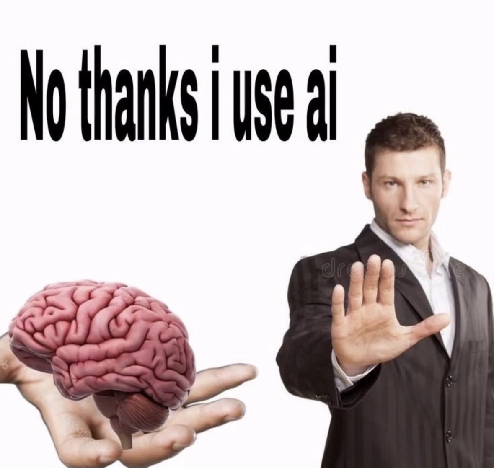
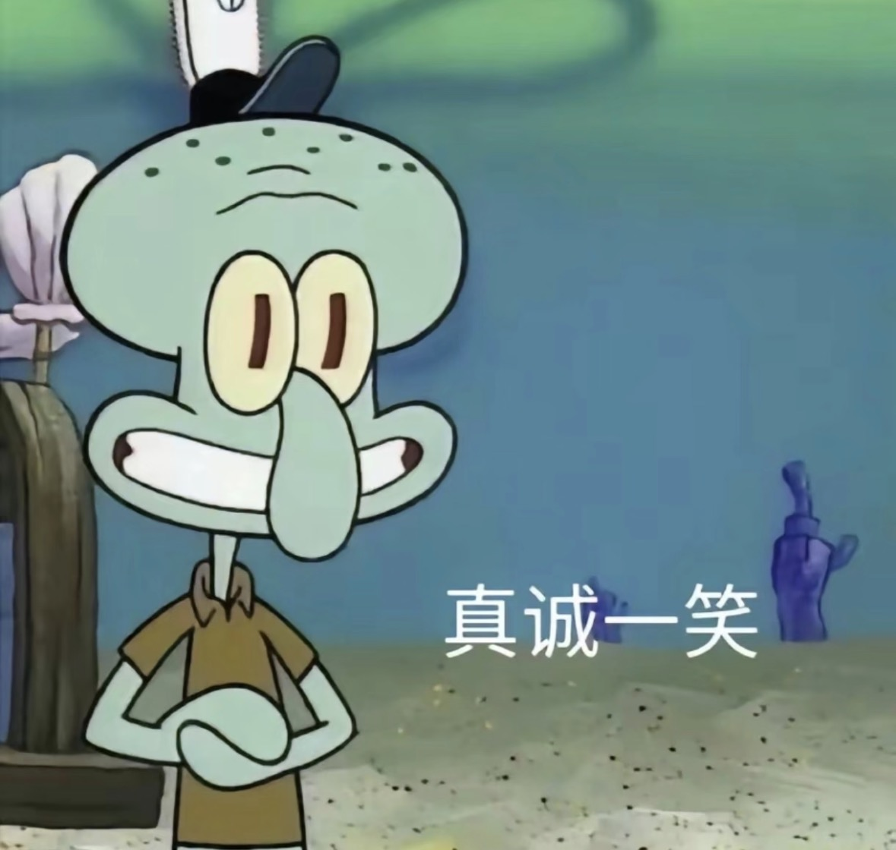

我一直觉得有一个 自己名字 + github.io 的网站超级酷，所以从大一开始就琢磨着给自己整一个。不过鉴于当时拿得出手的东西不多，再加上总觉得费半天劲搭完了可能也没什么人来看，我只坚持到学完 Hugo 的基础就速速放弃了。

那现在为什么突然狠下心来把它搭完了呢？因为我想找暑期实习，想让自己的作品集看起来生动立体一点。（但写一堆玩笑话真的会让它更生动立体吗……）

  

Anyway，本来我的计划是套个模板 / vibe 速通一下。但可能是因为我的需求有点奇葩，最后几乎是手搓了整个前端。（实现过程我整理到博客里了，如果您感兴趣可以点下面的链接：）

PS：写前端其实还挺开心的。如果 AI 没有像现在这么 nb 的话，我可能真的会去做前端。但没有如果，不嘻嘻。

  

好了回到正题，我的需求主要有三个：简洁明了、便于维护、各取所需。

前面两个很好理解，第三个稍微有点抽象：未来可能会有很多人因为各种原因打开这个网站，有的人可能只是想了解我的水平，有的人可能是想了解我这个人。我不太想用同一种方式去对待所有不同来意的人。

所以，如果你只是想了解我的能力，可以直接在主页浏览我的 Projects 和 Blog，那里记录了我目前所有的作品和探索。

如果你对作者本人稍微有一点点好奇的话，可以点进 About 页面。那里可能会不定期更新一些翻车项目、学习总结，或者别的乱七八糟的东西。

就这样，thanks for watching, and have fun.

  

