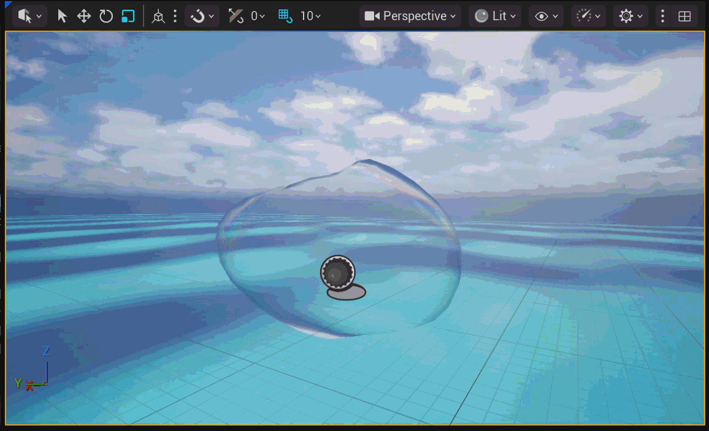
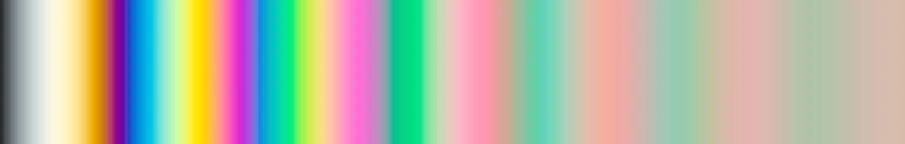
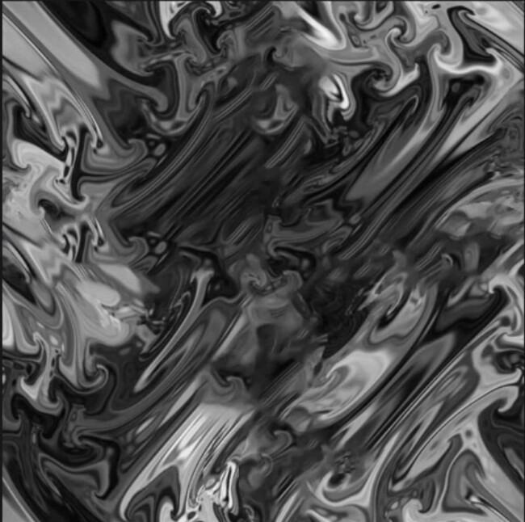

This bubble gets its shifting colors from a thin-film material and its ripples from Gerstner waves.



The Blueprint node graph below shows how the material is put together.


## The iridescent material

### Unreal Engine material settings

Start with the same settings you would use for glass.

- **Blend Mode** — Translucent
- **Lighting Mode** — Surface Translucency Volume

### What gives a bubble its colors?

Thin-film interference produces the rainbow colors on the surface of a soap bubble.


Two properties drive the color in this shader.

- **Angle of incidence.** Use the angle of the incoming light to choose a color from this gradient texture.

    

- **Film thickness.** Sample a noise texture made by converting a microscope photograph of a bubble to grayscale.



### 1. Angle of incidence


```glsl
u = 1 - (0.5 N·L + 0.5);
float2 uv = append(u, 0.5);
```


### 2. Film thickness


- Set **Metallic** to 1 for a fully specular surface response.
- Set **Roughness** to 0.
- Drive **Opacity** with a Fresnel node to make the film look thinner at the edges.

## Animating the ripples

Combine two Gerstner waves to make the surface ripple.

The time-dependent term for a Gerstner wave is `float speed = Time * SquareRoot(9.8 * 2PI / WaveLength);`

### Custom Gerstner wave node

**Inputs**

- `WorldPos` ← **AbsoluteWorldPosition**
- `Time` ← **Time**
- `WaveDirection` — direction of travel, such as `(1,0,0)` or `(0.7,0,0.7)`
- `WaveLength` — wavelength, supplied as a scalar parameter such as 200
- `WaveHeight` — wave height, supplied as a scalar parameter such as 5
- `PeakSharpness` — scalar from 0 to 1, such as 0.5

**Outputs**

- `Offset` (3 components) — displacement at the sample point
- `Normal` (3 components) — surface normal at that point

```csharp
// 1) Normalize the direction of travel in the XY plane.
float2 D = normalize(WaveDirection.xy);

// 2) Compute the wave number k.
// k = 2π / wavelength
float k = 6.2831853 / max(WaveLength, 1e-4);

// Angular frequency from the deep-water dispersion relation: w = sqrt(g * k).
float w = sqrt(9.81 * k);

// Wave amplitude.
float A = WaveHeight;

// Crest sharpness controls the strength of the horizontal displacement.
// Clamp it to [0, 1] to help prevent the wave from intersecting itself.
float Q = saturate(PeakSharpness);

// 3) Compute the phase as the wave travels through space and time.
// phase = k * (direction · position) - w * t
// dot(D, WorldPos.xy) gives the distance along the direction of travel.
// Subtracting w * Time advances the wave.
float phase = k * dot(D, WorldPos.xy) - w * Time;

// Compute sine and cosine once for reuse below.
float s = sin(phase);
float c = cos(phase);

// 4) Compute the vertical displacement
// of the Gerstner wave.
float offsetZ = A * s;

// 5) Extract the components of the wave direction.
float dX = D.x;
float dY = D.y;

// 6) Take the partial derivatives of the height function.
// These are used to compute the normal.
float dZdx = A * k * c * dX;
float dZdy = A * k * c * dY;

// 7) Compute the Jacobian of the horizontal mapping.
// In addition to moving vertically, points on a Gerstner wave
// move in the horizontal plane.
float dXdx = 1.0 - Q * A * k * s * dX * dX;
float dXdy = - Q * A * k * s * dX * dY;
float dYdx = - Q * A * k * s * dY * dX;
float dYdy = 1.0 - Q * A * k * s * dY * dY;

// 8) Construct tangent vectors for the surface
// along the X and Y directions.
float3 Tx = float3(dXdx, dYdx, dZdx);
float3 Ty = float3(dXdy, dYdy, dZdy);

// 9) Take the cross product of the tangents to find the normal.
// normal = normalize(Tx × Ty)
float3 N = normalize(cross(Tx, Ty));

// 10) Write the outputs.
// Vertical displacement.
out_offsetZ = offsetZ;
// Surface normal.
out_normal = N;
return 0;
```
