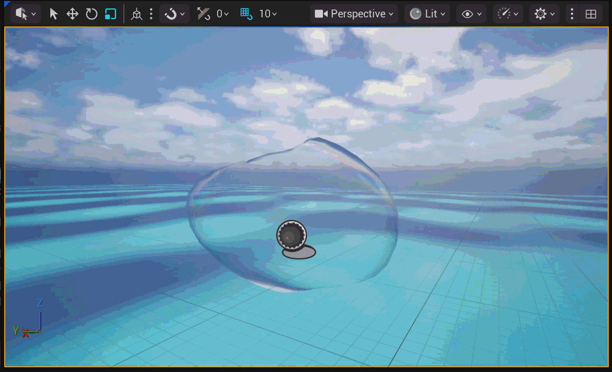
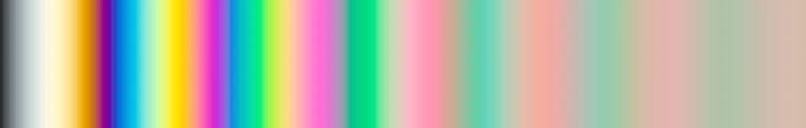
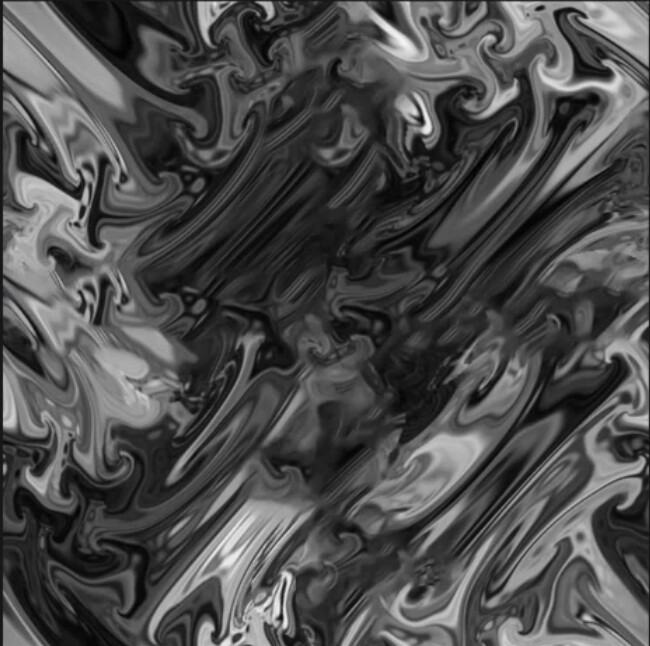

基于 Gerstner Wave 的五彩泡泡实现

  


蓝图节点：


五彩材质效果

## UE 材质设置

采用和玻璃一样的设置：

- Blend Mode：Translucent
- Lighting Mode：Surface Translucency Volume

## 怎么模拟泡泡？

产生彩虹效果的核心原理：薄膜干涉


由上图可知，彩色效果主要由以下两个因素决定：

- 自然光摄入角度——根据角度的不同来对以下进行贴图采样
    
    

    
- 薄膜厚度——采样特殊的噪声贴图：取泡泡显微摄影图片，转为灰色后得到

<p align="center">
  
</p>


### 1. 自然光摄入角度


```glsl
u = 1 - (0.5 N·L + 0.5);
float2 uv = append(u, 0.5);
```


### 2. 薄膜厚度


- metalic 设置成1：specular 设置成1的意思
- Roughness 设置成 0
- Opacity 使用 Fresnel 节点设置，边缘薄一点

## 波动效果

用两个 GerstnerWave  实现

GerstnerWave 的核心公式：`float speed = Time * SquareRoot(9.8 * 2PI / WaveLength);`

### 自定义 Gerstner Wave 节点

输入：

- `WorldPos` ← **AbsoluteWorldPosition**
- `Time` ← **Time**
- `WaveDirection` ← 例如 `(1,0,0)` 或 `(0.7,0,0.7)` 波的方向
- `WaveLength` ← 标量参数（如 200）波长
- `WaveHeight` ← 标量参数（如 5）波的高度
- `PeakSharpness` ← 标量参数（0~1，如 0.5）

输出

- `Offset（3）`← 计算后该点的位移
- `Normal（3）`← 计算后该点的法线

```csharp
// 1) 归一化波的传播方向（只使用 XY 平面）
float2 D = normalize(WaveDirection.xy);

// 2) 计算波数 k
// 波数公式：k = 2π / 波长
float k = 6.2831853 / max(WaveLength, 1e-4);

// 角频率 w，使用深水波色散关系：w = sqrt(g * k)
float w = sqrt(9.81 * k);

// 波幅（波浪高度）
float A = WaveHeight;

// 波峰尖锐度（控制水平位移强度）
// 限制在 [0,1] 范围，防止波浪自交
float Q = saturate(PeakSharpness);

// 3) 计算相位 Phase，表示波在空间 + 时间中的传播
// phase = k * (方向 · 位置) - w * t
// dot(D, WorldPos.xy) 表示沿波传播方向的距离
// - w * Time 表示随时间移动
float phase = k * dot(D, WorldPos.xy) - w * Time;

// 提前计算 sin 和 cos
float s = sin(phase);
float c = cos(phase);

// 4) 计算波的垂直位移
// Gerstner wave 的高度变化
float offsetZ = A * s;

// 5) 方向分量
float dX = D.x;
float dY = D.y;

// 6) 计算高度函数的偏导数
// 用于计算法线
float dZdx = A * k * c * dX;
float dZdy = A * k * c * dY;

// 7) 计算水平位移的 Jacobian
// Gerstner wave 不只是上下移动
// 还会产生水平位移
float dXdx = 1.0 - Q * A * k * s * dX * dX;
float dXdy = - Q * A * k * s * dX * dY;
float dYdx = - Q * A * k * s * dY * dX;
float dYdy = 1.0 - Q * A * k * s * dY * dY;

// 8) 构建切线向量
// 表示曲面在 X/Y 方向的变化
float3 Tx = float3(dXdx, dYdx, dZdx);
float3 Ty = float3(dXdy, dYdy, dZdy);

// 9) 通过叉乘计算法线
// normal = normalize(Tx × Ty)
float3 N = normalize(cross(Tx, Ty));

// 10) 输出结果
// 波浪高度偏移
out_offsetZ = offsetZ;
// 水面法线
out_normal = N;
return 0;
```