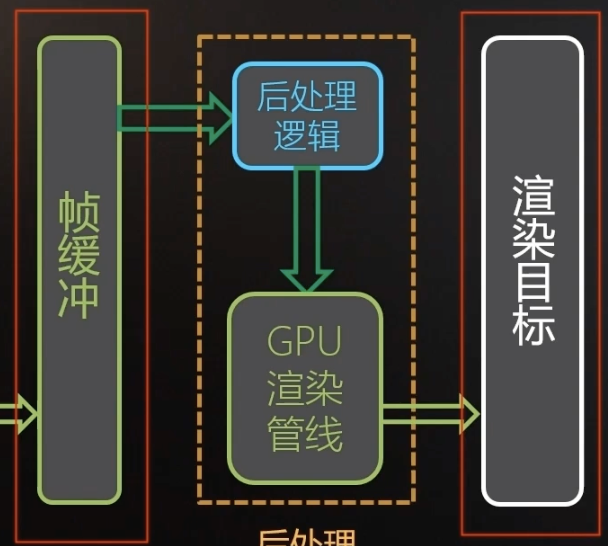
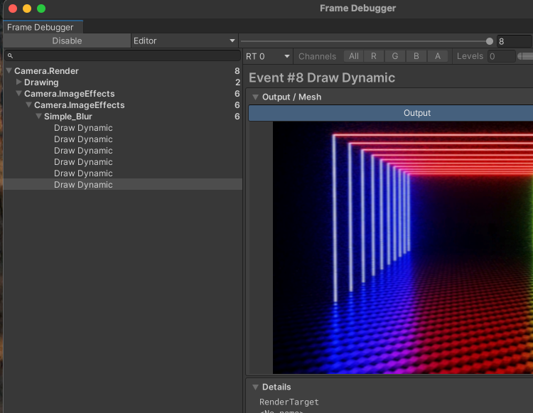
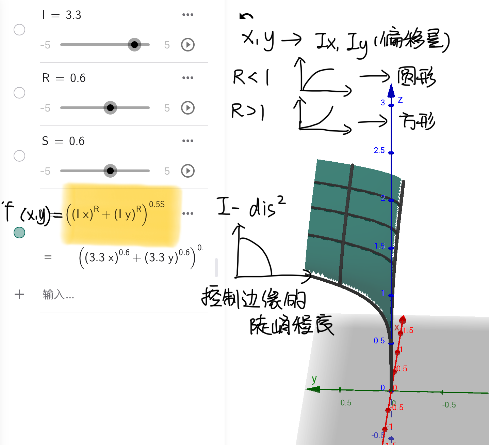
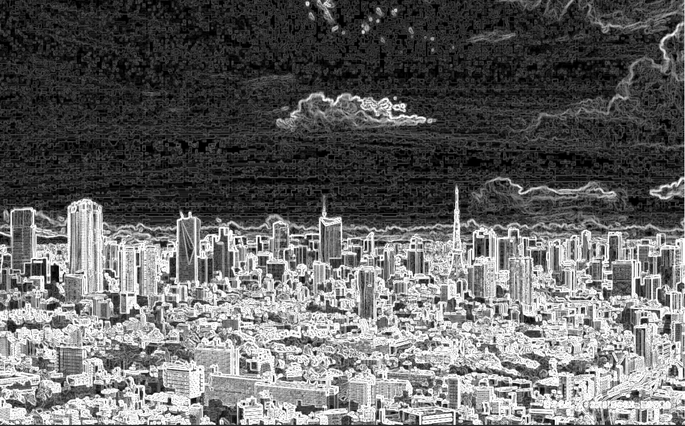
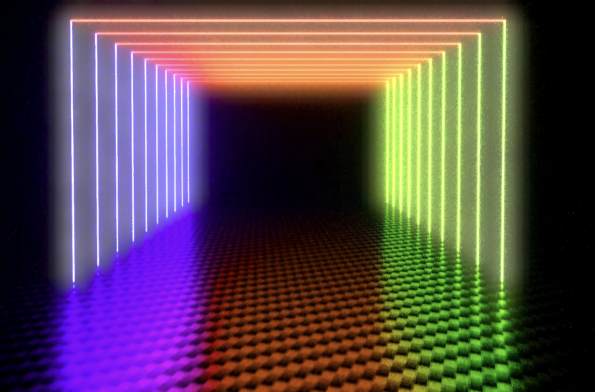

## Post-processing in the Built-in Render Pipeline

### How it works

The diagram shows where post-processing runs in the rendering pipeline.



Attach a script to the camera. Each time the camera finishes rendering, Unity calls the script’s `OnRenderImage` method.

```csharp
	void OnRenderImage(RenderTexture source, RenderTexture destination) {
	    Graphics.Blit(source, destination, material, "pass");
	}
}
```

The call that applies the effect is `Graphics.Blit(source, destination, material, pass)`. It takes the rendered frame through three steps.
1. Read the original image from the `source` render texture.
2. Draw it using the specified pass of `material`.
3. Write the result to `destination`.

`Graphics.Blit` issues a draw call that you can inspect in the Frame Debugger.



### Implementation

A post-processing effect has two parts.

1. Attach a post-processing script to the camera.
2. Write a shader that processes the camera image.

Here is the basic camera script.

```csharp
[ExecuteInEditMode()] // Run the effect in Edit mode as well.
[RequireComponent(typeof(Camera))] // Add a Camera if the GameObject does not already have one.
public class "ScriptName" : MonoBehaviour{
	public Material material;
	void Start () {
		if (material == null || material.shader == null || material.shader.isSupported == false){
		enabled = false;
		return;
	}
}
	// Unity calls this once per rendered frame on the camera.
	void OnRenderImage(RenderTexture source, RenderTexture destination) {
	    Graphics.Blit(source, destination, material, "pass");
	}
}
```

The shader below is a starting point for an effect such as a vignette. Its fragment function currently returns the original pixel color.

```csharp
Shader "EmageEffect/Sample"
{
    Properties
    {
        _MainTex ("Texture", 2D) = "white" {}
        // _MainTex receives the camera’s source image.
    }
    SubShader
    {
        // No culling or depth
        Cull Off
        ZWrite Off
        ZTest Always

        Pass
        {
            CGPROGRAM
            #pragma vertex vert_img; // Use the built-in vertex function for the fullscreen pass.
            #pragma fragment frag
            #include "UnityCG.cginc"

            sampler2D _MainTex;

            fixed4 frag (v2f_img i) : SV_Target
            {
                // Apply the post-processing operation here.
                float4 col = tex2D(_MainTex, i.uv);
                return col;
            }
            ENDCG
        }
    }
}
```

## Example effects

Note to self: bring over the rest of my tablet notes…

### 1. Vignette


The formula highlighted in yellow gives the falloff. The plot shows how it changes across the image.



The basic expression and the adjustable controls are shown below.

```csharp
// Basic falloff from the center:
float vfactor = 1.0 - length(i.uv - float2(0.5,0.5)) // Elliptical on a non-square image.
// Common vignette controls:
// _VignetteIntensity
float2 d = abs(i.uv - half2(0.5, 0.5)) * _VignetteIntensity;
// _VignetteRoundness
d = pow(saturate(d), _VignetteRoundness);
// _VignetteSmoothness
float vfactor = pow(saturate(1.0 - dist * dist), _VignetteSmoothness);
```

### 2. Outlines



To detect outlines, work through the following steps.

1. Sample the nine texels in a 3 × 3 neighborhood.
    - Account for the kernel flip when applying the convolution.
    - Use the shader’s `_MainTex_TexelSize` parameter to step by one texel.
2. Convert RGB to luminance before detecting edges.
    1. `0.2125 * r + 0.7154 * g + 0.0721 * b`
3. Apply the Sobel operator.

The three functions below implement those steps in order.

```csharp
    // Compute UV coordinates for the nine neighboring samples, including the center.
   void sample (v2f_img i, out half2 result[9] ){
        result[0] = i.uv + _MainTex_TexelSize.xy * half2(-1,-1);
        result[1] = i.uv + _MainTex_TexelSize.xy * half2(0,-1);
        result[2] = i.uv + _MainTex_TexelSize.xy * half2(1,-1);
        result[3] = i.uv + _MainTex_TexelSize.xy * half2(-1,0);
        result[4] = i.uv;
        result[5] = i.uv + _MainTex_TexelSize.xy * half2(1,0);
        result[6] = i.uv + _MainTex_TexelSize.xy * half2(-1,1);
        result[7] = i.uv + _MainTex_TexelSize.xy * half2(0,1);
        result[8] = i.uv + _MainTex_TexelSize.xy * half2(1,1);
    }

    // change the rgb to luminance
    fixed3 cal_luminance(fixed3 color){
        return  0.2125 * color.r + 0.7154 * color.g + 0.0721 * color.b;
    }

    // calculate convolution with sobel
    half sobel(half2 sampled[9]){
        const half Gx[9] = {-1,  0,  1,
                            -2,  0,  2,
                            -1,  0,  1};
        const half Gy[9] = {-1, -2, -1,
                            0,  0,  0,
                            1,  2,  1};
        half luminance = 0;
        half edgeX = 0;
        half edgeY = 0;
        for(int i = 0; i < 9; i++){
            luminance = cal_luminance(tex2D(_MainTex, sampled[i]));
            edgeX += luminance * Gx[i];
            edgeY += luminance * Gy[i];
        }
        half edge = abs(edgeX) + abs(edgeY);
        return edge;
    }
```

### 3. Bloom



The bloom pass extracts bright pixels, blurs them, and adds the result to the original image.

```text
[Source image] ──────────────────────────────────────────┐
      │                                                  │
      ▼                                                  ▼
[Extract highlights] → [Gaussian blur] → [Bloom texture] → [Composite]
                                                              │
                                                              ▼
                                                        [Destination]

```

The shader splits the work into passes.

```csharp
pass
{
	// threshold
}
pass // Horizontal blur
pass // Vertical blur
pass
{
	Blend One One // Optional; I prefer the look of additive blending here.
	// blend
}
```
