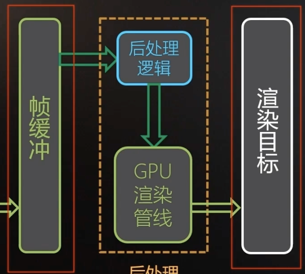
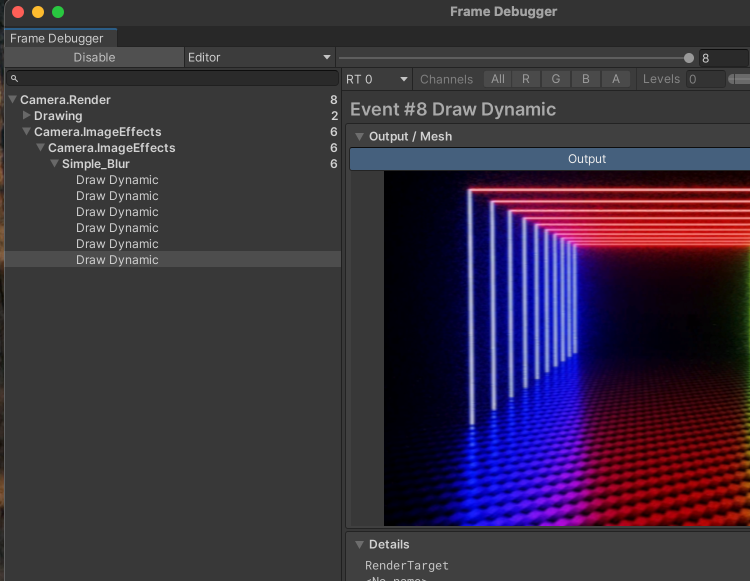
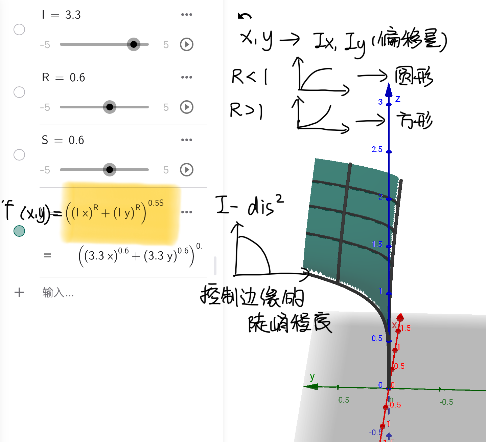
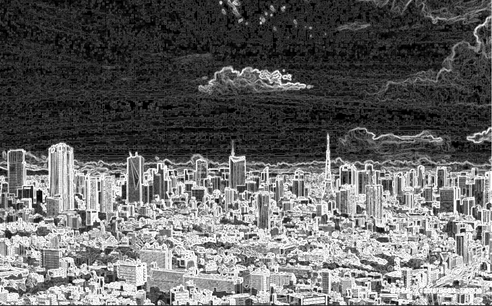
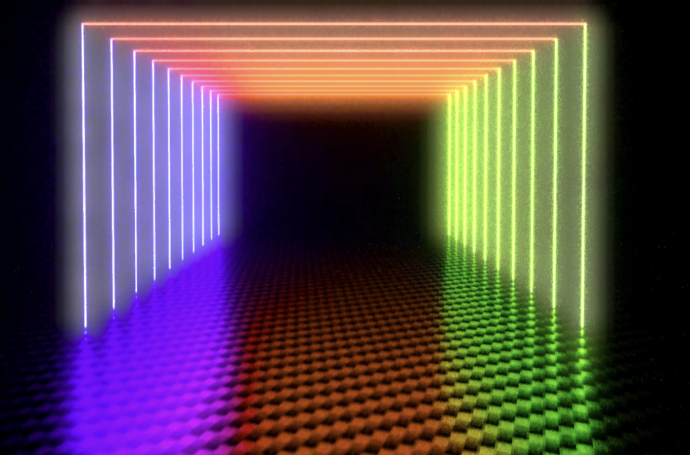

## 内置渲染管线的后处理原理

### 原理

渲染管线中后处理的位置：



后处理逻辑：摄像机调用 OnRenderImage( ) 函数（相关脚本挂在摄像机上），unity在每一个单位时间自动调用

```nasm
	void OnRenderImage(RenderTexture source, RenderTexture destination) {
	    Graphics.Blit(source, destination, material，"pass");
	}
}
```

- 核心操作：`Graphics.Blit(source, destination, material, pass)` ，这个函数先拿到后处理前的的原图，利用后处理 shader 处理它，结束后输出最终图，专业点讲就是：
    - 从 Render Texture source中取原图
    - 调用传入的 material
    - 把渲染完成的结果传到 destination
- Graphics.Blit 会调用 drawcall，可以在 Frame Debugger 里进行查看：



### 代码实现

实现后处理需要在以下两个地方更改代码：

1. 在 camera 上挂后处理脚本
2. 写后处理 shader最简单的后处理模板：

最简单的摄像机脚本：

```csharp
[ExecuteInEditMode()] //在编辑模式的时候就会被调用
[RequireComponent(typeof(Camera))] //查看当前的GO是否有camera组件，如果没有的话会自动添加
public class "ScriptName" : MonoBehaviour{
	public Material material;
	void Start () {
		if (material == null || material.shader == null || material.shader.isSupported == false){
		enabled = false;
		return;
	}
}
	// 每一帧都会执行一次，只能在 camera组件上生效
	void OnRenderImage(RenderTexture source, RenderTexture destination) {
	    Graphics.Blit(source, destination, material，"pass");
	}
}
```

最简单的后处理脚本（以暗角效果为例）：

```csharp
Shader "EmageEffect/Sample"
{
    Properties
    {
        _MainTex ("Texture", 2D) = "white" {}
        // 这里的_MainTex就是 camera 中的 source，即原图
    }
    SubShader
    {
        // No culling or depth
        Cull Off
        ZWrite Off
        ZTest Always

        Pass
        {
            CGPROGRAM
            #pragma vertex vert_img; // 后处理不会涉及 vert shader，所以直接调用内置函数
            #pragma fragment frag
            #include "UnityCG.cginc"

            sampler2D _MainTex;

            fixed4 frag (v2f_img i) : SV_Target
            {
		            // 进行后处理操作
								float4 col = tex2D(_MainTex, i.uv);
                return col;
            }
            ENDCG
        }
    }
}
```

## 简单案例

去把 pad 上的东西般过来…

### 1. 暗角


核心计算公式： 见黄色公式，效果见可视化图形



代码实现：

```csharp
//最基本的：
float vfactor = 1.0 - length(i.uv - float2(0.5,0.5)) //会是一个椭圆！
// 常见的暗角控制参数：
// _VignetteIntensity 
float2 d = abs(i.uv - half2(0.5, 0.5)) * _VignetteIntensity;
// _VignetteRoundness
d = pow(saturate(d), _VignetteRoundness);
// _VignetteSmoothness
float vfactor = pow(saturate(1.0 - dist * dist), _VignetteSmoothness);
```

### 2. 描边



实现方式：

1. 9 x 9的采样
    1. 在这一步做了卷积翻转
    2. shader的`_MainTex_TexelSize` 参数
2. 边缘检测的预处理：rgb --> luminance
    1. `0.2125 * r + 0.7154 * g + 0.0721 * b`
3. 采用 sobel 算子进行计算

核心代码：三个核心函数，分别进行步骤1，步骤2，步骤3

```csharp
   // 采样贴图附近九个点
   void sample (v2f_img i, out half2 result[9] ){
        result[0] = i.uv + _MainTex_TexelSize.xy * half2(-1,-1);
        result[1] = i.uv + _MainTex_TexelSize.xy * half2(0,-1);
        result[2] = i.uv + _MainTex_TexelSize.xy * half2(1,-1);
        result[3] = i.uv + _MainTex_TexelSize.xy * half2(-1,0);
        result[4] = i.uv;
        result[5] = i.uv + _MainTex_TexelSize.xy * half2(1,0);
        result[6] = i.uv + _MainTex_TexelSize.xy * half2(-1,1);
        result[7] = i.uv + _MainTex_TexelSize.xy * half2(0,1);
        result[8] = i.uv + _MainTex_TexelSize.xy * half2(1,1);
    }

    // change the rgb to luminance
    fixed3 cal_luminance(fixed3 color){
        return  0.2125 * color.r + 0.7154 * color.g + 0.0721 * color.b; 
    }

    // calculate convolution with sobel
    half sobel(half2 sampled[9]){
        const half Gx[9] = {-1,  0,  1,
                            -2,  0,  2,
                            -1,  0,  1};
        const half Gy[9] = {-1, -2, -1,
                            0,  0,  0,
                            1,  2,  1};	
        half luminance = 0;
        half edgeX = 0;
        half edgeY = 0;
        for(int i = 0; i < 9; i++){
            luminance = cal_luminance(tex2D(_MainTex, sampled[i]));
            edgeX += luminance * Gx[i];
            edgeY += luminance * Gy[i];
        }
        half edge = abs(edgeX) + abs(edgeY);
        return edge;
    }
```

### 3. Bloom



实现原理：

```csharp
[原图 source]
      │
      ▼
[提取亮区] ——> [高斯模糊] ——> [bloom纹理]
      │                        ▲
      └────────── 合成 ────────—┘
                    ↓
              [destination]
```

在 shader 中的体现：

```csharp
pass
{
	// threshold
}
pass // Horizontal blur
pass // Vertical blur
pass
{
	Blend One One //不必要，但是效果确实更好看
	// blend 
}
```