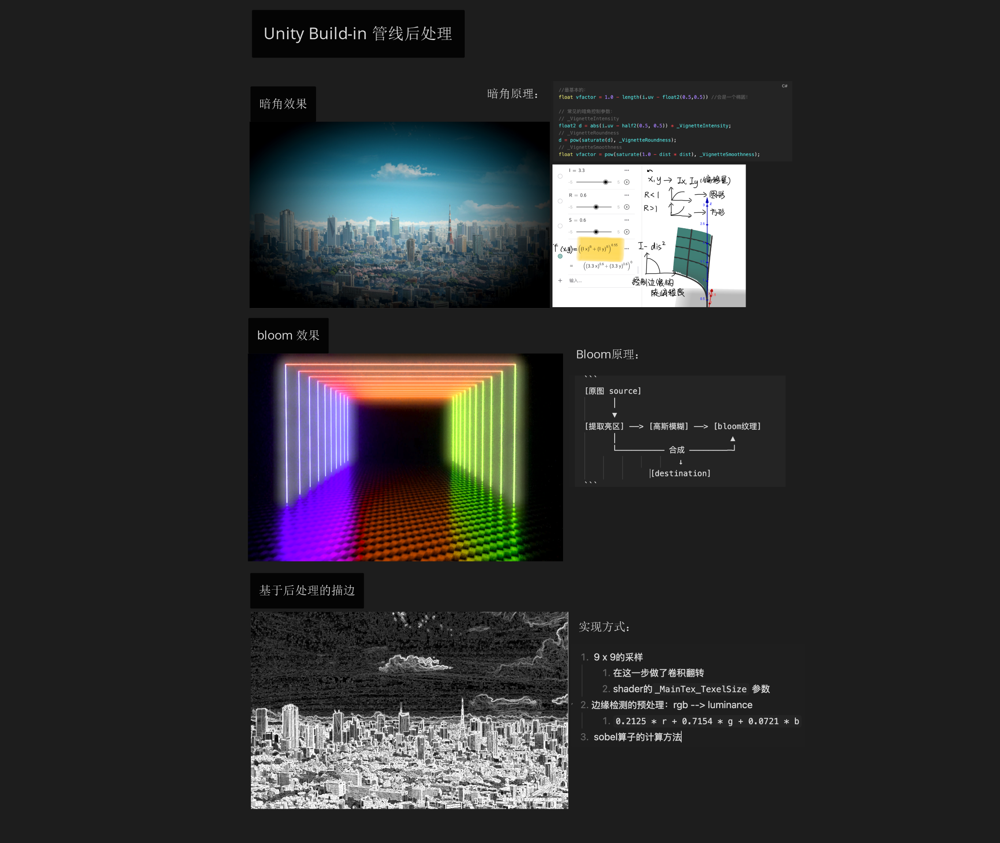

## Heading Level 2

This post verifies common Markdown rendering in Hugo page bundles.

**This text is bold**

*This text is italic*

- First bullet
- Second bullet
  - Nested bullet

Inline math-like text can stay as plain content for now: `v_{i,t}` and `1/2`.

```python
for i in range(n):
    print(i)
```

| I | am | a | table |
| --- | --- | --- | --- |
| This | is | a | row |
| Hugo | now | renders | it |

> [!NOTE]
> This is a callout rendered through a Hugo blockquote render hook.
> It is useful for notes, warnings, and tips.

> This is a regular blockquote.

[My GitHub](https://github.com/SeraSix)

Image with custom width:



Video inside the page bundle:


