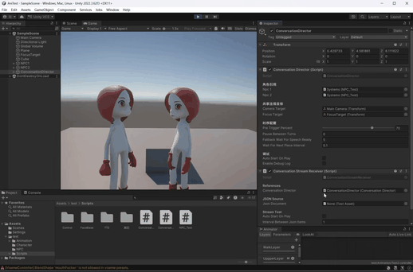
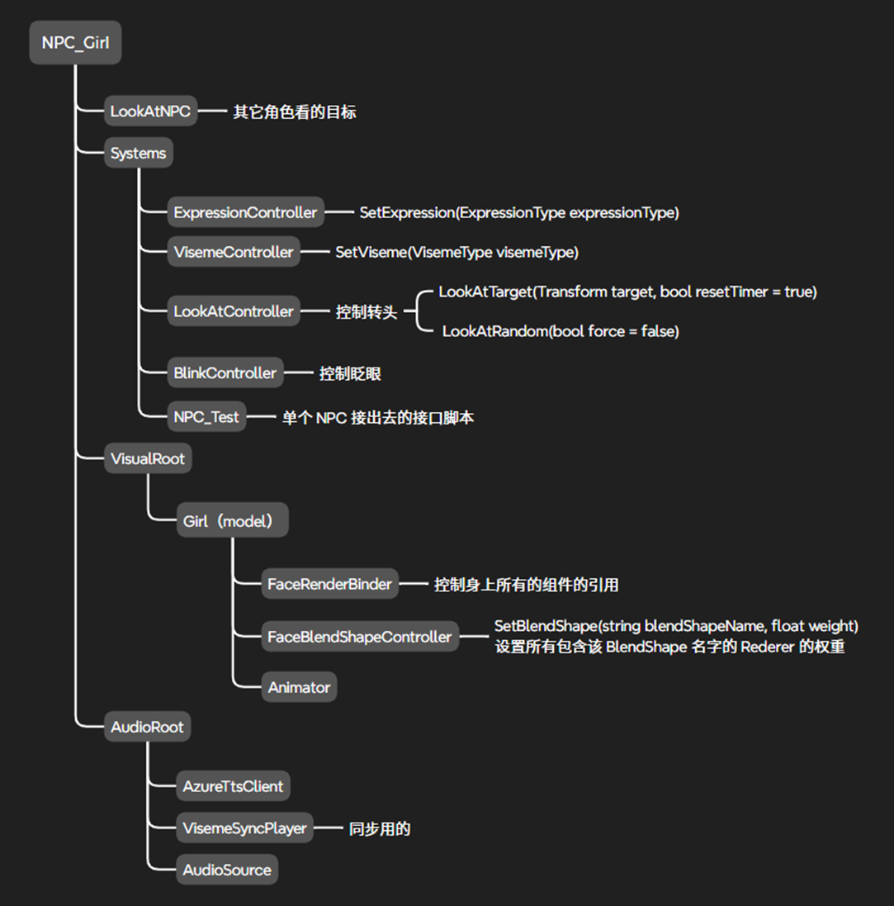

## AI 虚拟人动画

演示视频:
  

整体架构：

  

## 动画系统

### 总框架：

#### ARkit 分通道

一共三个 System 负责

- `ExpressionController`：只产出“表情目标值”
- `VisemeController`：只产出“口型目标值”
- `LookAtController`：只控制骨骼旋转 / 眼球方向

ExpressionController 负责的通道:

```
browDownLeft / Right
browInnerUp
browOuterUpLeft / Right

cheekPuff
cheekSquintLeft / Right

eyeBlinkLeft / Right
eyeSquintLeft / Right
eyeWideLeft / Right

jawLeft / Right

mouthDimpleLeft / Right
mouthFrownLeft / Right
mouthLeft / Right
mouthShrugLower / Upper
mouthSmileLeft / Right
mouthUpperUpLeft / Right

noseSneerLeft / Right
```

VisemeController 负责的通道:

```
jawForward
jawOpen
mouthClose
mouthFunnel
mouthLowerDownLeft / Right
mouthPressLeft / Right
mouthPucker
mouthRollLower
mouthRollUpper
mouthStretchLeft / Right
```

LookAtController 接管，不直接走 BlendShape:

```
eyeLookDownLeft / Right
eyeLookInLeft / Right
eyeLookOutLeft / Right
eyeLookUpLeft / Right
eyeBlinkLeft / Right
```

#### 底层接口

主要组件：

- FaceRendererBinder: 获取所有可用于面部BlendShape控制的Renderer，存入`SkinnedMeshRenderer[] result` , 以便于可以统一设置所有组件上相关的形态键

  

- FaceBlendShapeController：用于统一设置 / 清空某一个形态键

```csharp
public void ResetAllBlendShapes()

public void SetBlendShape(string blendShapeName, float weight)

public void SetBlendShapeOnRenderer(SkinnedMeshRenderer smr, string blendShapeName, float weight)
    
```

#### 动画分层

<div style="display: grid; grid-template-columns: repeat(3, 1fr); gap: 16px;">
  
  
  
</div>

- Walk：以后用来 handle 跟随行走动画
- UpperLayer：负责说话时的动作
- LookAt：叠加头部动画

---

### 说话动作逻辑

- 用动画树（2D Freeform Cartesian）来在一定程度随机生成说话动画
    - TalkStyle 0-1
    - TalkIntensity 0-1

| 动画 | TalkStyle | TalkIntensity |
| --- | --- | --- |
| talk1_small | 0 | 0 |
| talk1_strong | 0 | 1 |
| talk2_small | 1 | 0 |
| talk2_strong | 1 | 1 |


  

- Intensity 和表情有关：

```csharp
    private float GetTalkDensity(EmotionType type)
    {
        switch (type)
        {
            case EmotionType.Think:
                return 0.5f;
            case EmotionType.Disaprove:
                return 0.6f;
            case EmotionType.Aprove:
                return 0.2f;
            case EmotionType.Angry:
                return 0.8f;
            case EmotionType.Sad:
                return 0f;
            default:
                return 0f;
        }
    }
```

- TalkStyle 为随机在 1 / 2 里筛选

### Expression 逻辑

Expression Controller:

```csharp
Start()
↓
ApplyExpression(当前表情)

Update()
↓
如果表情变了
↓
ApplyExpression(新表情)

外部调用：
SetExpression(...)
↓
ApplyExpression(...)
```

表情预设：

Happy:

```
mouthSmileLeft / Right = 80
cheekSquintLeft / Right = 40
eyeSquintLeft / Right = 20
browOuterUpLeft / Right = 10
```

Surprise:

```
jawOpen = 60
eyeWideLeft / Right = 80
browInnerUp = 70
browOuterUpLeft / Right = 50
mouthFunnel = 30
```

Sad:

```
mouthFrownLeft / Right = 70
browInnerUp = 60
browDownLeft / Right = 30
eyeSquintLeft / Right = 20
jawOpen = 10
```

Angry:

```
browDownLeft / Right = 80
eyeSquintLeft / Right = 50
mouthPressLeft / Right = 60
jawForward = 20
```

编辑器里可以手动调节：

  

### 口型逻辑

- Viseme 控制逻辑

```csharp
Start()
↓
ApplyViseme(VisemeType 当前口型) 

Update()
↓
如果口型变了
↓
ApplyViseme(VisemeType 新口型)

外部调用：
SetViseme(VisemeType visemeType)
↓
ApplyViseme(VisemeType visemeType)
```

Viseme 预设

```csharp
public enum VisemeType
{
    None,
    Closed,
    A_Open,
    A_Wide,
    I,
    U,
    O,
    FV,
    L,
    SZ,
    SHCH,
    Rest
}

// 设置了例如以下的：
new VisemePreset
{
    visemeType = VisemeType.Closed,
    blendShapes = new List<BlendShapeValue>
    {
        new BlendShapeValue { shapeName = "mouthClose", value = 40f },
        new BlendShapeValue { shapeName = "mouthPressLeft", value = 35f },
        new BlendShapeValue { shapeName = "mouthPressRight", value = 35f },
        new BlendShapeValue { shapeName = "jawOpen", value = 0f }
     }
},
```

   

### Blink 逻辑

BlinkController

- 通过 `FaceBlendShapeController.SetBlendShape()`  去控制 `eyeBlinkLeft` 和 `eyeBlinkRight`
- 核心代码逻辑：

```csharp
Update()
  ↓
是否需要眨眼？
  ↓ 是
StartBlink(): 1. 随机生成眨眼强度 2. _blinkState = BlinkState.Closing;
  ↓
UpdateBlink() 三个case：不眨眼 / BlinkState.Closing / BlinkState.Opening
  ↓
Closing：闭眼 0 -> 目标值
  ↓ 一段时间间隔后  _blinkState = BlinkState.Opening 
Opening：睁眼 目标值 -> 0
  ↓
ScheduleNextBlink()
  ↓
回到 Update()
```

### LookAt 逻辑

```csharp
Update()
  ↓
检查引用和目标是否有效
  ↓
ComputeEyeTarget()
  ↓
ComputeHeadTarget()
  ↓
UpdateEyeLogic()
  ↓
UpdateHeadLogic()
```

- compute 部分逻

眼睛：

```csharp
目标位置
  ↓
转换到 eyeReference 的局部坐标
  ↓
取 localOffset.x 计算水平偏移
取 localOffset.y 计算垂直偏移
  ↓
根据 eyeHorizontalLimit / eyeVerticalLimit 限制最大角度
  ↓
归一化成 -1 ~ 1
  ↓
乘以 eyeHorizontalWeight / eyeVerticalWeight
  ↓
减去当前头部转动量 _currentHeadX
  ↓
MoveTowards 平滑移动
  ↓
写入 eyeLook... BlendShape

```

头：

```csharp
目标位置
  ↓
转换到 headReference 的局部坐标
  ↓
用 atan2(localOffset.x, localOffset.z) 算水平角度
  ↓
限制在 headHorizontalLimit 范围内
  ↓
根据距离计算响应强度
  ↓
归一化成 -1 ~ 1
  ↓
判断是否超过 deadZone
  ↓
等待眼睛先转到一定程度
  ↓
头部开始跟随
  ↓
MoveTowards 平滑转头
  ↓
写入 Animator 参数

```

- update 部分逻辑

眼睛部分：set blend shape：

```csharp
faceController.SetBlendShape("eyeLookUpLeft", eyeLookUpLeft);
faceController.SetBlendShape("eyeLookUpRight", eyeLookUpRight);
faceController.SetBlendShape("eyeLookDownLeft", eyeLookDownLeft);
faceController.SetBlendShape("eyeLookDownRight", eyeLookDownRight);
```

动画部分逻辑：

  

## 其它

### TTS 解决方案

与 tts 的连接逻辑：

使用的是微软的 Azure 服务，使用了 unity 外的 python 脚本

传过去：

```csharp
class TtsRequest(BaseModel):
    text: str
    voice: str = "zh-CN-XiaoxiaoNeural"
    style: Optional[str] = None
    rate: str = "0%"
    pitch: str = "0%"
    volume: str = "0%"
    request_viseme: bool = True
    emotion: Optional[str] = "neutral"
```

传回来：

```json
{
  "ok": true,
  "audio_base64": "UklGRiQAAABXQVZF...",
  "audio_format": "wav",
  "sample_rate": 24000,
  "channels": 1,
  "duration_ms": 1234.5,
  "visemes": [
    {
      "audio_offset_ticks": 500000,
      "audio_offset_ms": 50.0,
      "viseme_id": 3,
      "animation": "..."
    }
  ],
  "expression": {
    "primary": "neutral",
    "intensity": 0.35
  },
  "words": []
}
```

- 接收逻辑

```csharp
SpeakCoroutine(text)
        ↓
初始化状态
_isPreparing = true
_isReadyToTalk = false
_hasPlaybackStarted = false
_hasPlaybackCompleted = false
talking = false
        ↓
处理旧的音频 / update audisource 和 visemeSyncPlayer
        ↓
构造 AzureTtsRequest，想服务器请求 UnityWebRequest POST serverUrl
        ↓
yield return request.SendWebRequest()等待服务器返回
        ↓
        ↓ 如果请求成功
        ↓
读取 responseJson
JsonUtility.FromJson<AzureTtsResponse>()，设置检验逻辑
        ↓
        ↓
audio_base64：需要转换成 AudioClip
        ↓
Convert.FromBase64String(...) 返回：wavBytes
WavUtility.ToAudioClip(...) 返回：AudioClip clip
        ↓
        ↓ 
同时启动音画逻辑：
把 AudioClip 交给 AudioSource：audioSource.clip = clip;
把 Visemes 交给 visemeSyncPlayer visemeSyncPlayer.LoadTimeline(response.visemes)
        ↓
        ↓
音频 + 口型时间线准备完成
_isPreparing = false
_isReadyToTalk = true
        ↓
等待 talking == true  yield return new WaitUntil(() => talking)
        ↓
AudioSource.Play()
        ↓
_hasPlaybackStarted = true
_hasPlaybackCompleted = false
        ↓
visemeSyncPlayer.Play()
        ↓
_isReadyToTalk = false
        ↓
如果 resetTalkingAfterPlaybackStarts == true
talking = false
        ↓
等待音频播放结束
yield return new WaitWhile(() => audioSource.isPlaying)
        ↓
_hasPlaybackCompleted = true
_speakCoroutine = null
        ↓
协程结束

```

- 播放逻辑
1. 用代码让 tts 返回类似这样的结构体：

```csharp
public LipSyncFrame(float timeMs, VisemeType visemeType)
{
    this.timeMs = timeMs;
    this.visemeType = visemeType;
}
```

核心代码逻辑：

```csharp
Update()
↓
检查是否正在播放
↓
检查 audioSource / visemeController 是否有效
↓
检查音频是否结束
    ↓
    如果结束：Stop()

↓
检查时间轴是否为空
↓
读取当前音频播放时间
↓
根据时间推进到对应的口型节点
↓
取得目标口型 target
↓
如果目标口型 != 当前口型
    ↓
    SetCurrentViseme(target)
    ↓
    更新当前口型
```

- 核心同步原理：
1. AzureTtsClients 处同时申请 AudioSource 和 VisemeSyncPlayer
2. VisemeSyncPlayer 按照 AudioSource 的时间播放

```csharp
float currentTimeMs = audioSource.time * 1000f;
VisemeType target = _timeline[_currentIndex].visemeType;
```

### 双人调度逻辑

- ConversationStreamReceiver：负责接收输入

```csharp
StartReading()
  ↓
StartStreamConversation()
  ↓
ReadTalkPiece()
  ↓
EnqueueTalkPiece() // 用Queue 来存储流式输入
  ↓
.....
  ↓
CompleteReading()
  ↓
MarkStreamCompleted()
```

- ConversationDirector：负责调度 NPC 怎么说、什么时候说、谁听谁

```csharp
确定说话人 speaker
确定听话人 listener
  ↓
准备当前句 TTS
  ↓
等待 TTS ready
  ↓
listener 进入听状态，看向 speaker
  ↓
speaker 开始说话
  ↓
说到 preTriggerPercent 时，提前准备下一句
  ↓
当前句说完
  ↓
speaker 结束说话
  ↓
如果下一句还没来，就进入 Thinking 等待

```