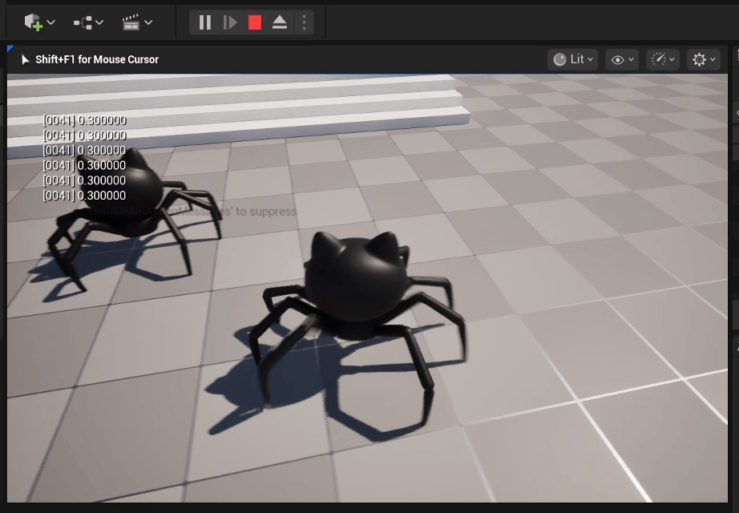
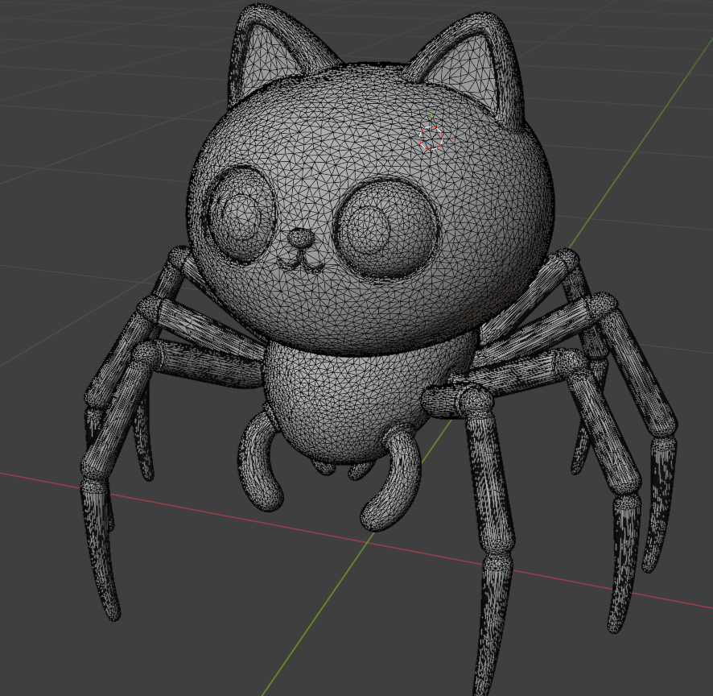

# CatSpider

 


# 模型生成与处理

混元3D 生成模型:
 


处理后：
 


# 绑定

自定义骨架
 


# Control Rig 逻辑

 


## Foot Lock 逻辑

### 1. 计算 Cycle

为了达到速度越大摆腿越快的效果，需要根据速度调节 cycle

1. 算适应于相关速度的 Cycle 时间：CycleLengthInSeconds

 


1. 更改 Cycle 的增长速度

 


### 2. 变化 FootLockedArray (booleans)

- `saturate(FootOffset[i] + CyclePercent)` 与 `SwingPercent` 相比
    - 在 swing time 内移动，在剩下时间 lock
- 更新逻辑如下
 


### 3. 解除锁定时更新位置
 


## World Position 计算逻辑

### 1. 脚步长度预测

核心：选择合适落点

PredictedFootTransforms = WorldFinalFootTransforms + Velocity * Something

 


$$
\text{Something}
=
\left[
S-p+\frac12(1-S)
\right]T
$$

- S=SwingPercent：摆动阶段占整个周期的比例
- p=PerFootCyclePercent：当前这只脚在周期中的进度
- T=CycleLengthInSeconds：一个完整步态周期的时长
- v=Velocity：身体的世界速度

它其实可以拆成两段时间：

$$
\underbrace{(S-p)T}_{\text{距离摆动结束还有多久}}
+
\underbrace{\frac12(1-S)T}_{\text{支撑阶段的一半}}
$$

```csharp
0                 S                 S + ½(1-S)                 1
|------ Swing -----|------ 前半支撑 ------|------ 后半支撑 ------|
当前 p             落地                  支撑中点
```

```csharp
刚落地：脚在身体前方
    ↓
支撑中点：脚大致位于身体正下方,**身体追上脚**
    ↓
离地前：脚位于身体后方,身体超过脚
```

### 2. Foot Lift

z 方向的 transform：

- 曲线 x 值：Swing 的进程
- 曲线 y 值：定义的高度

 


### 3. Land Track 碰撞检测

 


在落脚点的垂直直线上进行碰撞检测，设置碰撞点为落脚点

 


更好的方式：

 


## 更新逻辑：

核心：Set Full Body IK

 
