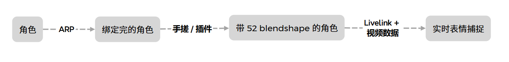
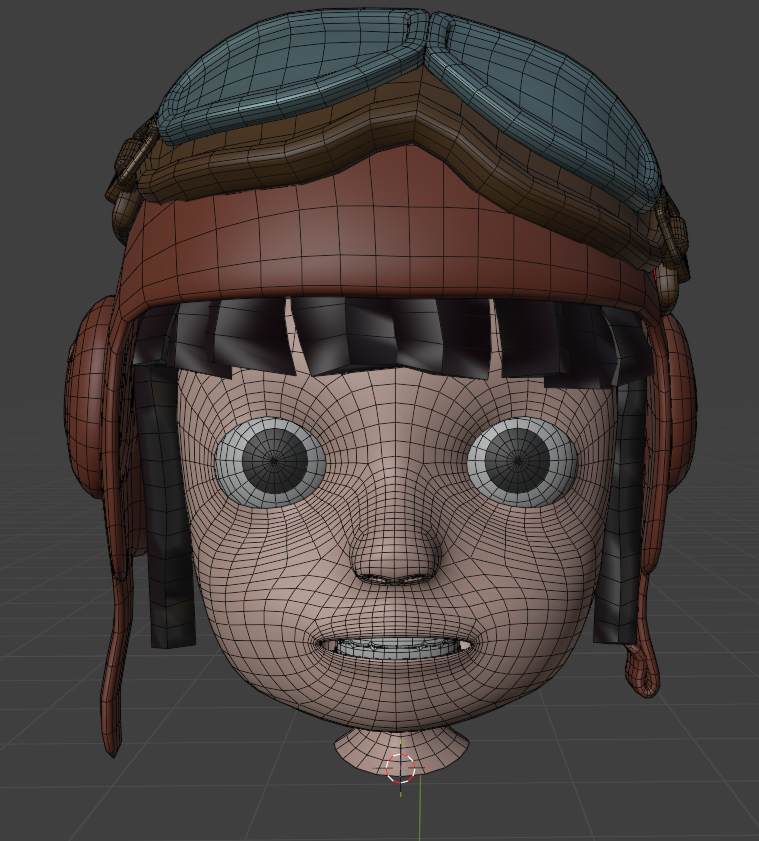
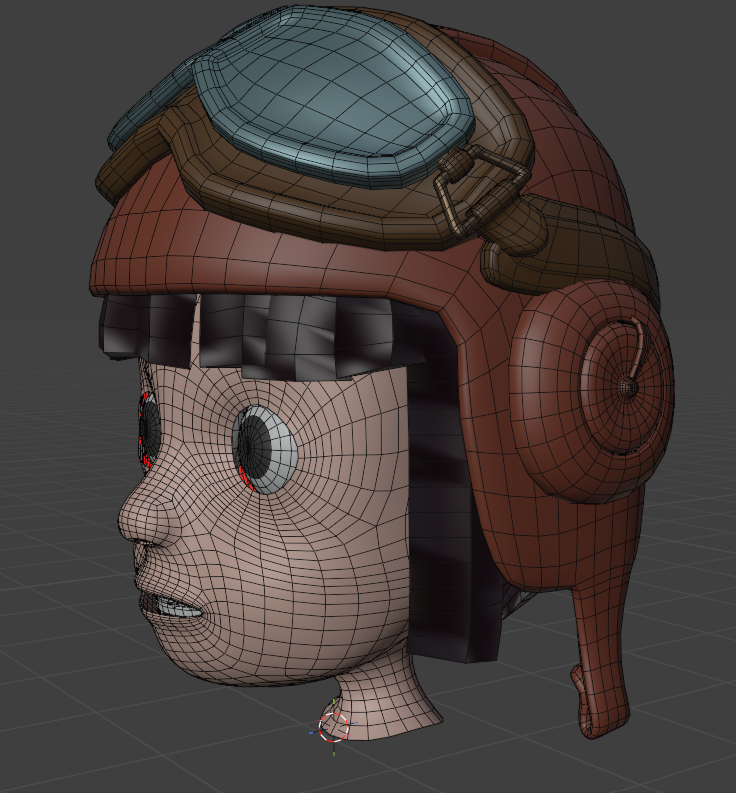
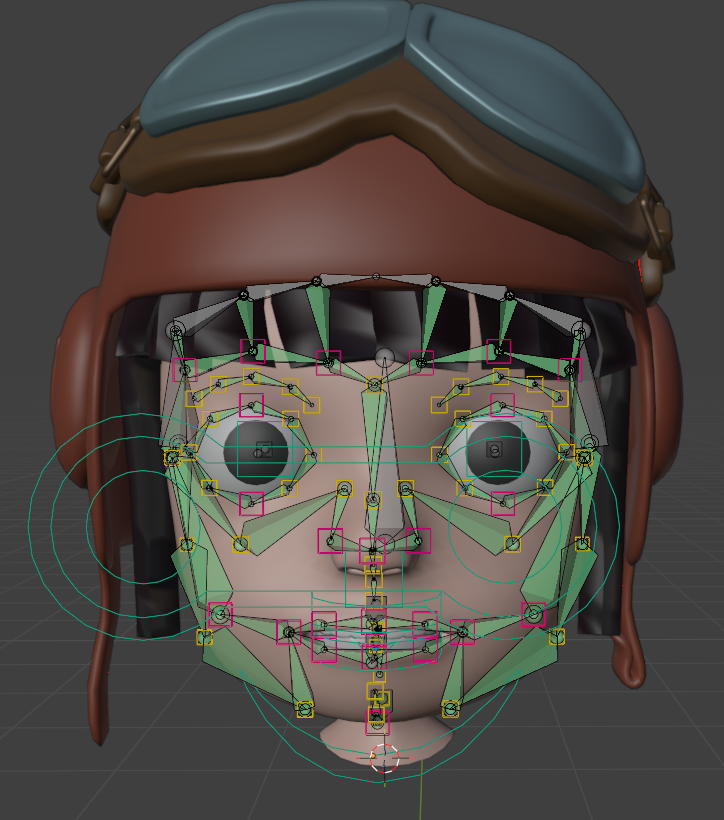
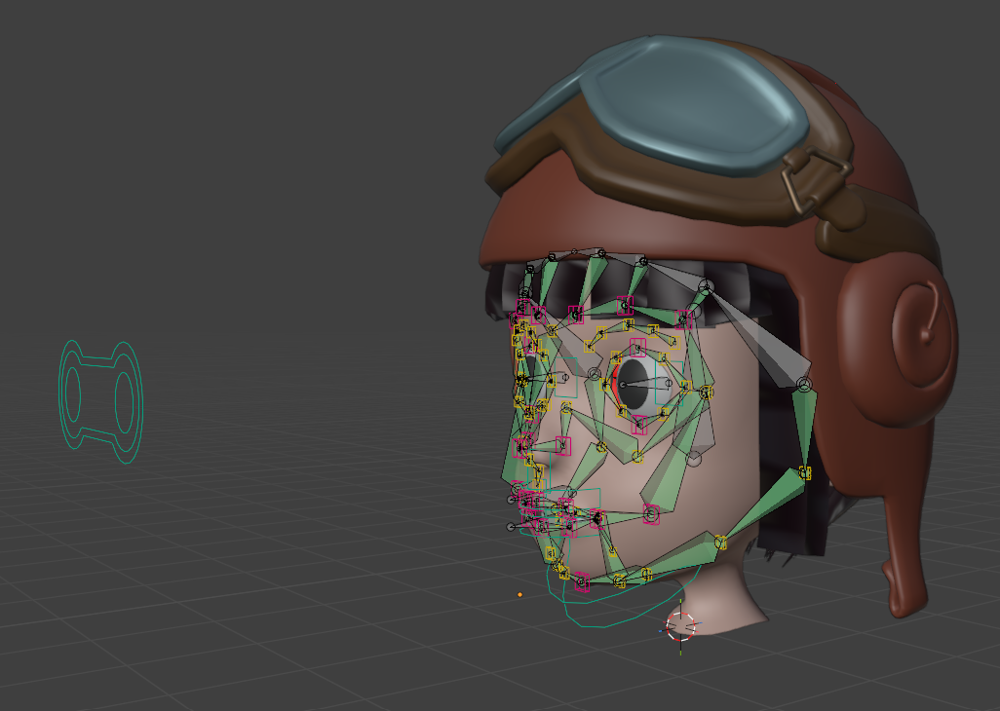
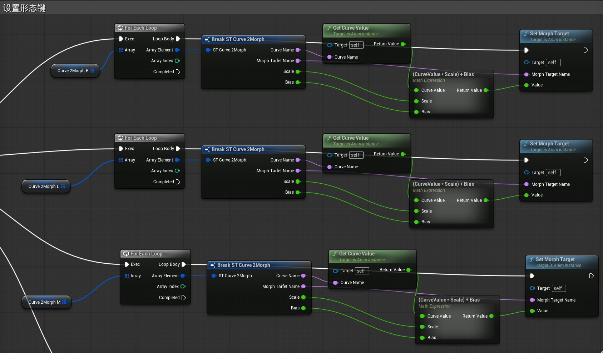
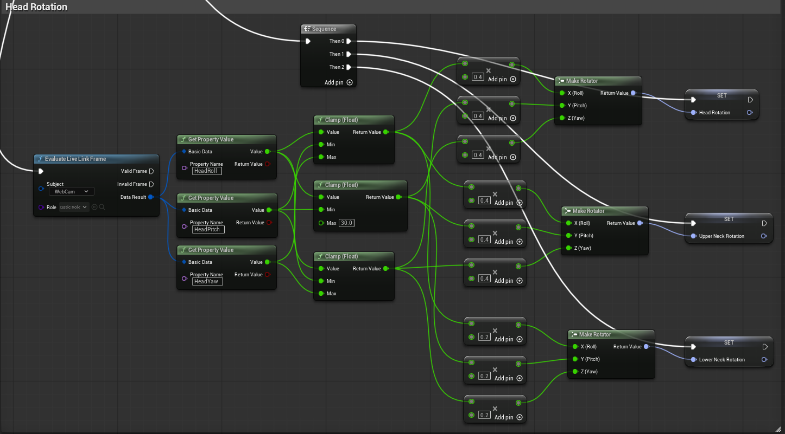

## Overview

The final performance


The capture pipeline



## Modeling and rigging the face

<!-- 
 -->

<div style="display: grid; grid-template-columns: repeat(2, 1fr); gap: 16px;">
  
  
</div>

I rigged the face with the Faceit facial armature.

<!-- 
 -->

<div style="display: grid; grid-template-columns: repeat(2, 1fr); gap: 16px;">
  
  
</div>

## Painting skin weights

I refined the weights while testing individual poses, including an open mouth, a smile, and a downward gaze.

<div style="display: grid; grid-template-columns: repeat(2, 1fr); gap: 16px;">
  
  
  
  
</div>

## Creating shape keys

I created the 52 ARKit facial shape keys.
<p align="center">
  
</p>

Here are some of the shapes in motion.

The six clips show the eyes, nose, cheeks, and mouth.
<div style="display: grid; grid-template-columns: repeat(2, 1fr); gap: 16px;">
  
  
  
  
  
  
</div>

## Reading and applying Live Link data

Once the model was ready, I imported it into Unreal Engine. The animation data takes the following path.

```text
Live Link Source
↓
LiveLinkRemapAsset
(remap curve names and values)
↓
Animation Blueprint
(read animation curves)
↓
Set Morph Target
↓
Character expression
```

### Reading the live data

I used Unreal Engine’s MetaHuman capture input to read 260 curve values in real time.

<p align="center">
  
</p>

### Driving the shape keys in real time

- From the 260 input values, I chose the closest match for each of the 52 ARKit shapes. Here’s a test of the mapping.
<p align="center">
  
</p>

- I used a list of objects to simplify the setup for the 52 shapes.
- For debugging, I grouped the shapes by the part of the face they affect: left, center, or right.



The table shows the mapping for paired shapes, using the left side as the example.

| ARKit / Faceit | MetaHuman Curve |
| --- | --- |
| browDownLeft | CTRL_expressions_browDownL |
| browOuterUpLeft | CTRL_expressions_browRaiseOuterL |
| cheekSquintLeft | CTRL_expressions_eyeCheekRaiseL |
| eyeBlinkLeft | CTRL_expressions_eyeBlinkL |
| eyeLookDownLeft | CTRL_expressions_eyeLookDownL |
| eyeLookInLeft | CTRL_expressions_eyeLookRightL |
| eyeLookOutLeft | CTRL_expressions_eyeLookLeftL |
| eyeLookUpLeft | CTRL_expressions_eyeLookUpL |
| eyeSquintLeft | CTRL_expressions_eyeSquintInnerL |
| eyeWideLeft | CTRL_expressions_eyeWidenL |
| mouthDimpleLeft | CTRL_expressions_mouthDimpleL |
| mouthFrownLeft | CTRL_expressions_mouthCornerDepressL |
| mouthLowerDownLeft | CTRL_expressions_mouthLowerLipDepressL |
| mouthPressLeft | CTRL_expressions_mouthPressDL |
| mouthSmileLeft | CTRL_expressions_mouthCornerPullL |
| mouthStretchLeft | CTRL_expressions_mouthStretchL |
| mouthUpperUpLeft | CTRL_expressions_mouthUpperLipRaiseL |
| noseSneerLeft | CTRL_expressions_noseWrinkleL |

These shapes have no separate left and right versions.

| ARKit / Faceit | MetaHuman Curve |
| --- | --- |
| browInnerUp | CTRL_expressions_browLateralL |
| cheekPuff | CTRL_expressions_mouthCheekBlowL |
| jawForward | CTRL_expressions_jawFwd |
| jawLeft | CTRL_expressions_jawLeft |
| jawOpen | CTRL_expressions_jawOpen |
| jawRight | CTRL_expressions_jawRight |
| mouthClose | CTRL_expressions_mouthLipsPurseUL |
| mouthFunnel | CTRL_expressions_mouthFunnelUL |
| mouthLeft | CTRL_expressions_mouthLeft |
| mouthRight | CTRL_expressions_mouthRight |
| mouthPucker | CTRL_expressions_mouthLipsPurseUR |
| **mouthRollLower** | CTRL_expressions_mouthLowerLipRollInL |
| **mouthRollUpper** | CTRL_expressions_mouthUpperLipRollInL |
| mouthShrugLower | CTRL_expressions_jawChinRaiseDL |
| mouthShrugUpper | CTRL_expressions_jawChinRaiseUL |
| tongueOut | CTRL_expressions_tongueOut |

### Driving head rotation

I read `HeadRoll`, `HeadPitch`, and `HeadYaw` to drive the skeletal animation.


