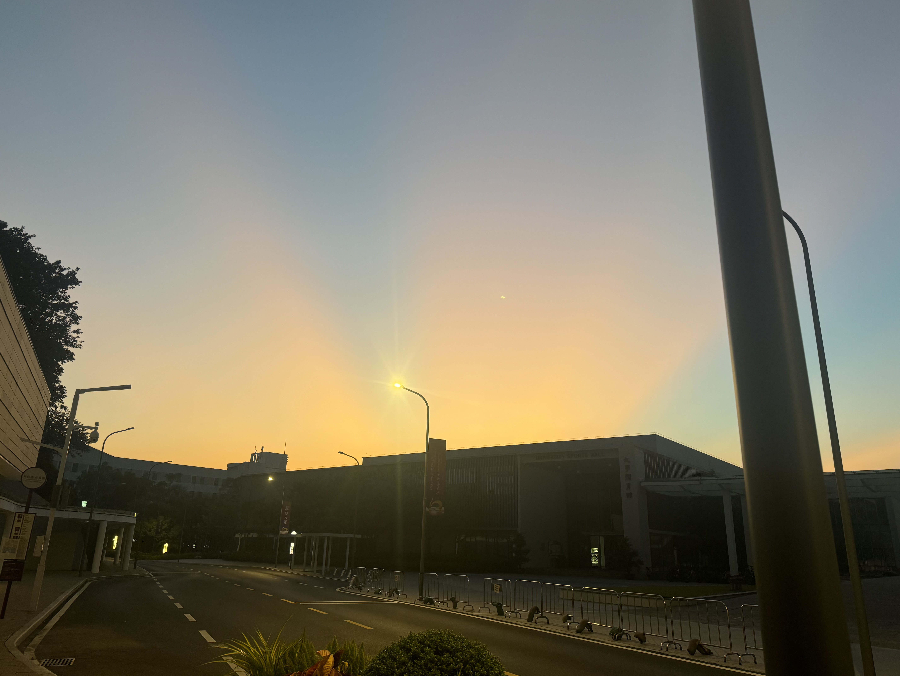

[Play Night at the 8th Warehouse in your browser](https://ldjam.com/events/ludum-dare/56/night-at-the-8th-warehouse)

I was the only artist on our team for Ludum Dare 56.

## Overview

### Game screens

---

### In-game animations

  

    
    
Idle

  

  

    
    
Run

  

  

    
    
Walk

  

  

    
    
Push

  

  

    
    
Forward roll

  

  

    
    
Death

  

### Credits and final results (my name is highlighted)

## Looking back

It’s hard to remember what was going through my head while I made all this. I’d just started university. I barely knew my way around a game engine, had never learned the principles of animation, and drew every frame by hand. My drawing had plenty of room for improvement, too…

The result fell short of what I’d hoped for. I spent much of the next year feeling embarrassed, especially after talking up my skills when we formed the team.

I went back and forth about putting this work up here. In the end, almost everything on this site can be traced back to LD56. It still feels a bit unreal that I nearly skipped the club’s team-forming session because I wanted to go back to my dorm for a nap.

Through the jam I found a wonderful game development club and met someone I can imagine spending my life with. I also got an early taste of the freedom of making games on my own schedule. Cue the self-teaching and the skipped classes. (Was that last part such a good idea?)

Here’s the sunrise at the end of the jam. The campus buses weren’t running yet, and none of us could find anywhere open for breakfast, so we went straight back to the dorms to sleep. It was the first all-nighter of my life.

