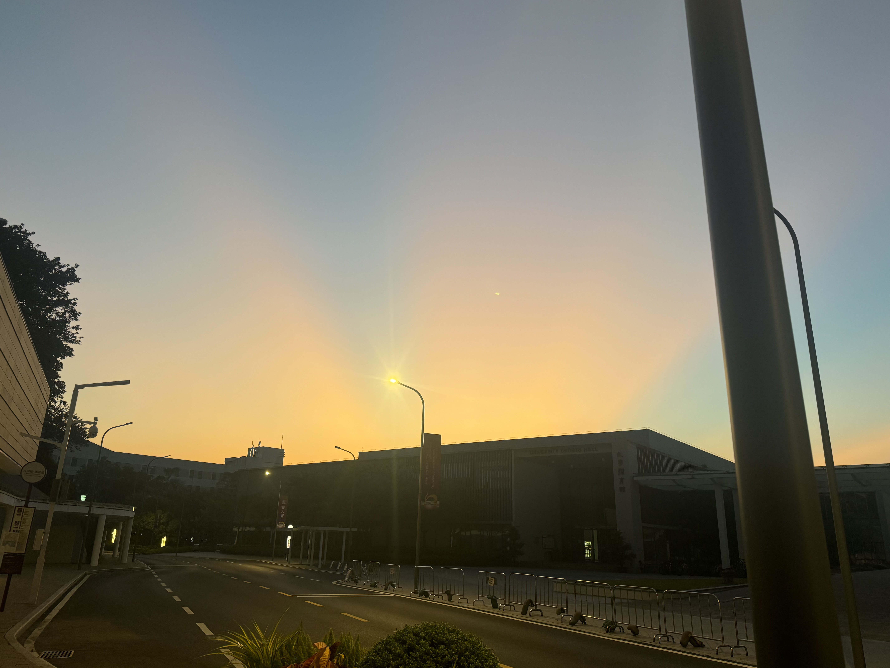

[网页连接，点开就能玩](https://ldjam.com/events/ludum-dare/56/night-at-the-8th-warehouse)

第56届 Luduam Dare Game Jam， 担任团队唯一的美术

## 概览

### 游戏页面

---

### 局内动画

  

    
    
站立

  

  

    
    
跑

  

  

    
    
走路

  

  

    
    
推

  

  

    
    
前滚翻

  

  

    
    
死亡动画

  

### Credit和最终成绩（标亮的是我）

## 后记

现在已经很难想完成这些时是什么心理状态了...... 当时我刚上大学，完全不熟悉游戏引擎，不懂动画原理，所有东西都是一张一张画的（然而这个绘画水平也没有很好....）

最后结局也不尽如人意，后面一年都因为这个很自卑，毕竟我组队时吹嘘了自己多么多么厉害来着（

不过纠结了半天还是把当时的东西都放上来了，大概是因为没有 LD56 就没有这个网站里的几乎一切。现在想想也挺不真实的，我差点就因为想回寝室睡觉而错过社团的组队讲座

Anyway，很幸运通过这次比赛加入了很棒的游戏研究社，认识了一位可以相伴一生的人。很幸运在大学的开始就收获了游戏制作者自由松弛的 lifestyle，从此开始自学与翘课（真的好嘛...）。

结尾放一张 LD 结束时拍的日出。那天早上校巴还没有开始运营，一行人因为找不到地方吃早饭只能直接回寝室睡觉，那还是我人生第一次熬通宵。

