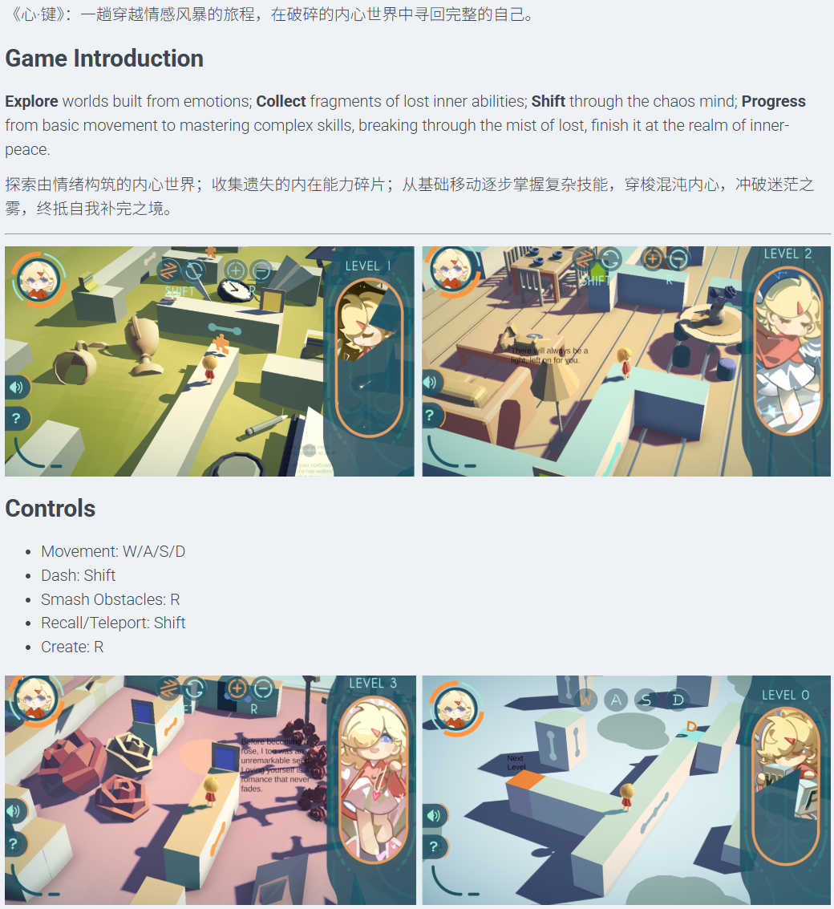
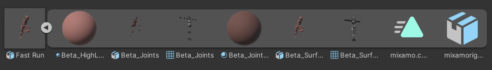
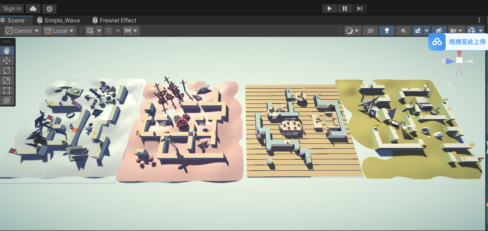
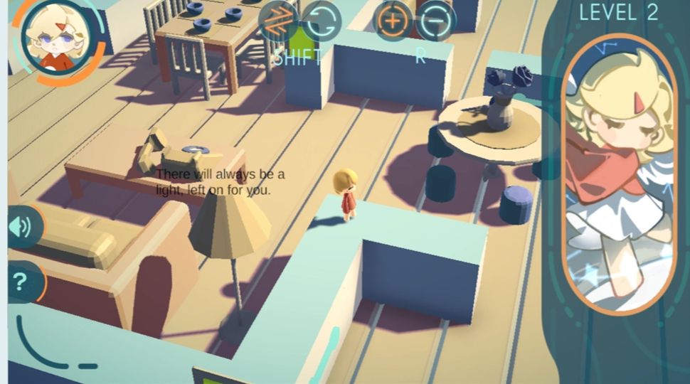

## Overview

I was the lead artist and technical artist on our team for Ludum Dare 58. We finished in 19th place.

[Play HeartKeys in your browser](https://ldjam.com/events/ludum-dare/58/heart-keys)

Credits and final results (my name is highlighted below)

## Technical breakdown

**My roles:** lead artist and technical artist.

I coordinated the art team’s work and handled the technical side of the 3D assets.

### Third-person character animation

A fixed camera frames the player, and an animation state machine controls the character’s movement.

[Character movement controller source code](https://github.com/SeraSix/Unity_Reusable/blob/main/3rdPerson/Move_Controller.cs)

### Character modeling, rigging, and animation

  
  
  

Unity Avatar setup

  
  

### Input System

I configured the input actions and wrote the [character controller](https://github.com/SeraSix/Unity_Reusable/blob/main/3rdPerson/Move_Controller.cs).

## Modeling the environment and props

A wide shot of the scene and some close-ups follow.

  

  

  

## Looking back

This was the game I made after a year of practice following LD56. We went for a bright, low-poly look that felt comforting. We placed much higher than I expected, and it was lovely to hear how much people enjoyed it.

The biggest challenge was coordinating a large art team entirely online. After spending the first day arguing, we gradually figured out a division of work that suited everyone. For the next jam, I’d like to get better at talking things through with the game designers…

  

A few details from the level design are worth sharing.

In HeartKeys, each key stands for finding your way through a moment of uncertainty as you grow up. That idea also runs through the main loop: collect new abilities and use them to solve puzzles. We built three levels around school, family, and love. Completing them opens the final level, the future.

We half-buried enormous objects in sand to suggest the character’s inner turmoil. The idea came from a still in [a video by Koala on Bilibili](https://www.bilibili.com/video/BV1Wju1zrE2q/?spm_id_from=333.1387.upload.video_card.click).

The family level took a different direction. The designers felt strongly that the buried objects made it too hard to see where to go. We ended up with a tidy, empty two-bedroom apartment. I think its emptiness captured something about being a teenager and feeling misunderstood at home.

My favorite part of the love level is the gathering of roses and swords. The inspiration was a Georgian hillside covered in swords, pictured on the right. The story goes that a small army won a battle there against a much larger force a thousand years ago. The swords became a tribute to their courage.

That’s roughly how teenage love feels to me: the impulse to risk absolutely everything. My teammates took one look at the roses and swords and decided I must have had a very dramatic emo phase.

  
  

We chose low poly partly because time was short and I still had plenty to learn. It also helped that I love *Dancing Line*. (Thank you, *Dancing Line*!)

That’s about it. Here’s the team who made the game!

