## 简介：

第58届 Luduam Dare Game Jam， 担任团队的主美和技美，最终成绩：19 

[网页连接，点这就能玩](https://ldjam.com/events/ludum-dare/58/heart-keys)

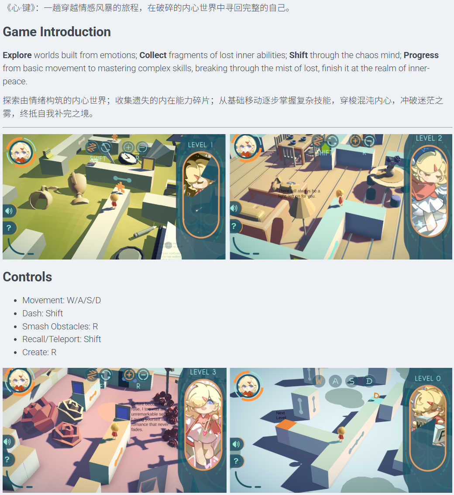

Credit和最终成绩（标亮的是我）：

  
  

## 技术拆解

队内分工：主美 + 技美

负责对内分工 + 负责 3D 的技术部分 

### 第三人称动画控制

固定相机视角 + 动画状态机

代码：https://github.com/SeraSix/Unity_Reusable/blob/main/3rdPerson/Move_Controller.cs

### 人物建模 + 绑定 + 动画

  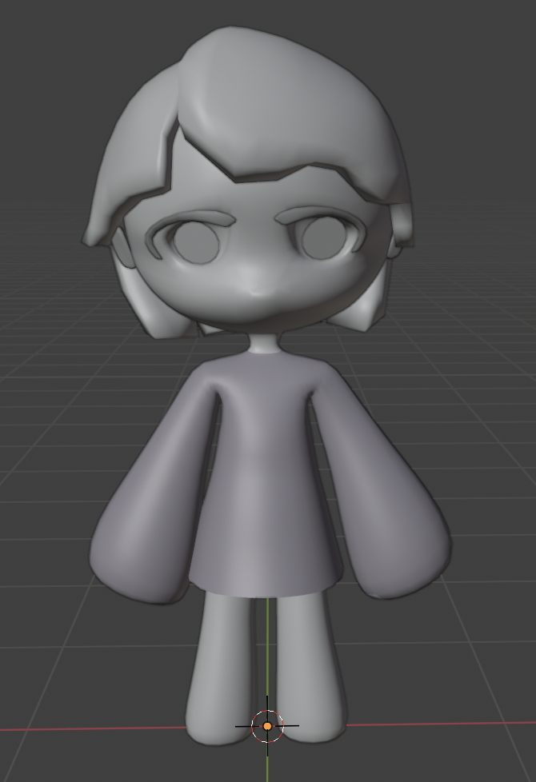
  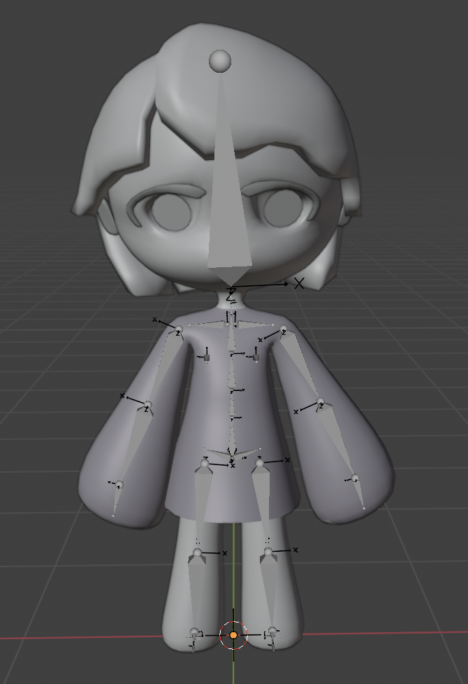
  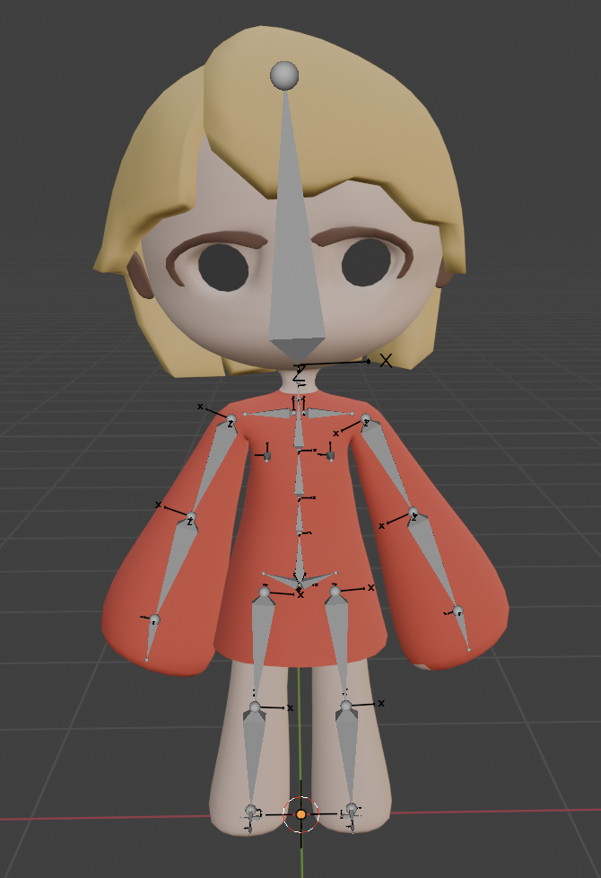

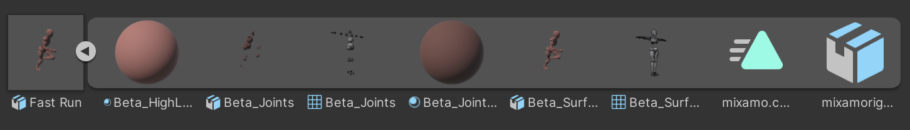

Unity Avatar 设置：

  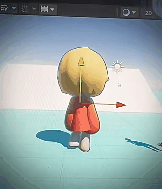
  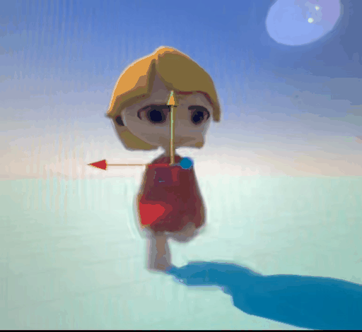

### Input System

设置 + 控制代码编写[（代码在这里）](https://github.com/SeraSix/Unity_Reusable/blob/main/3rdPerson/Move_Controller.cs)

## 场景所有物件建模

大场景图片：

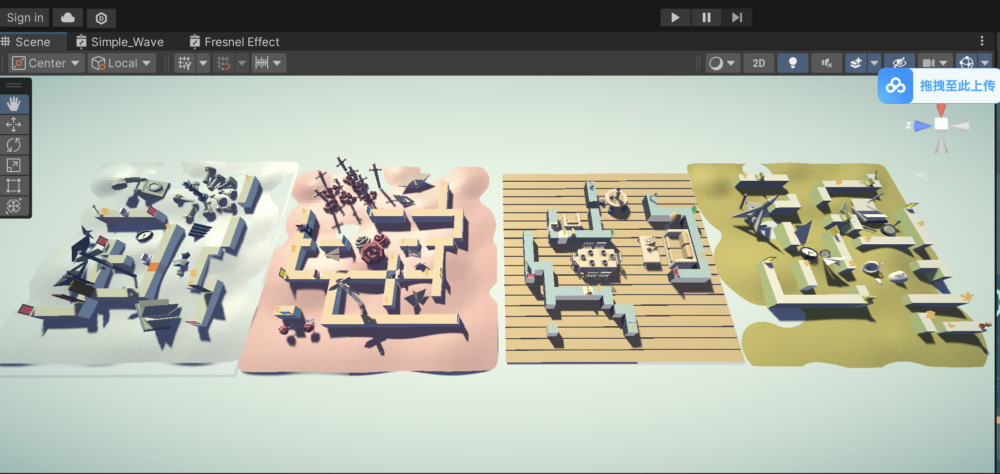

  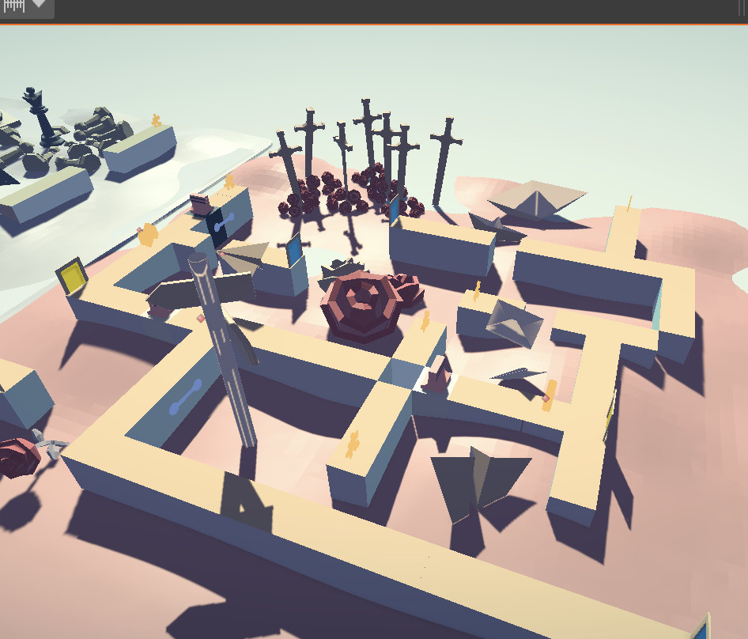

  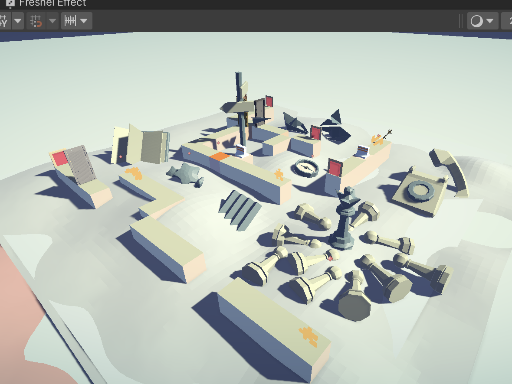

  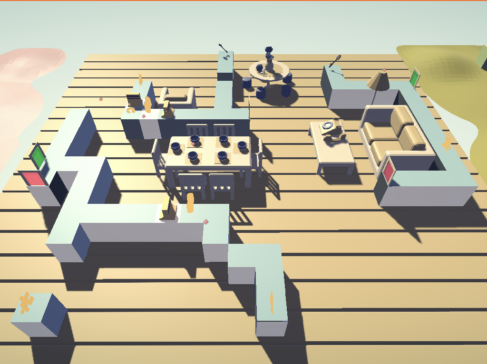

## 后记

LD56 之后修炼了一年的作品，鲜艳 + lowpoly 的治愈美术风格，最后取得了比预期高了好多的成绩也收获了很多好评

这次最大的挑战是美术团队很庞大 + 全在线上。不过好在美术小组吵了一天的架之后大家逐渐找到了合适的分工，倒是下次还得练练怎么和策划沟通….

  

下面聊一聊场景设计的小巧思

我们的游戏名叫 Heart Key，钥匙象征着在成长过程中克服迷茫的过程，正好呼应了游戏的核心玩法 “ 不断收集技能，解开谜题”。为了描绘这个过程，我们选择了校园，家庭，爱情这三个主题，通过这三关后可以到达未来关卡（最后一关）。

我们采用了 “把巨大物体掩埋在沙地” 里的方式来表达内心混沌，灵感来源于b站[考拉老师](https://www.bilibili.com/video/BV1Wju1zrE2q/?spm_id_from=333.1387.upload.video_card.click)的一张视频截图。

然而家庭主题关卡并没有延续这一风格，起因是因为不利于视觉引导遭到了策划团队的强烈反对 :(  后面改成了排列整齐但空无一人的两室一厅，反倒有了一种 “青少年在家里无法得到理解” 的韵味。

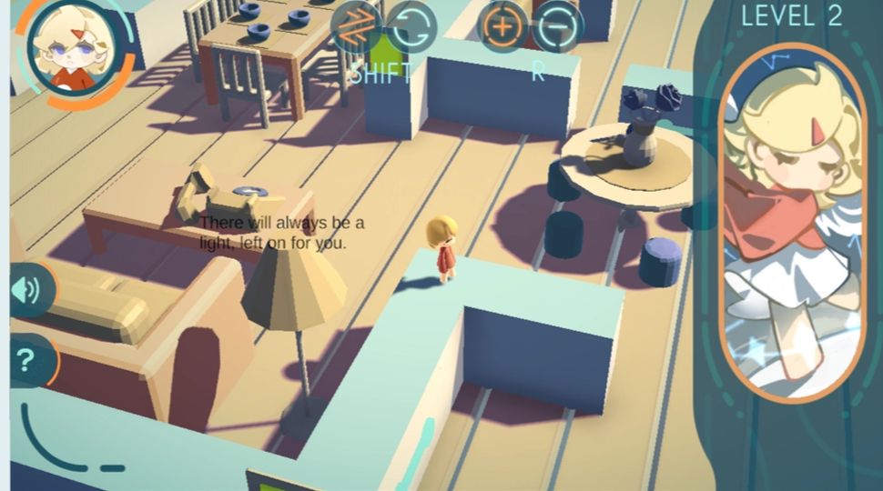

爱情关卡中最值得拿出来说的是这一堆玫瑰和一堆剑，这里的设计灵感来源于格鲁吉亚的圣剑山（见右图）。据说这里铭记了千年前的一场以少胜多的战役，后来成为了勇气的赞歌。

这大概是我理解的少年时期的爱情，颇有点赌上一切奋不顾身的冲动，可惜被我的队友们都认为我喜欢葬爱（

  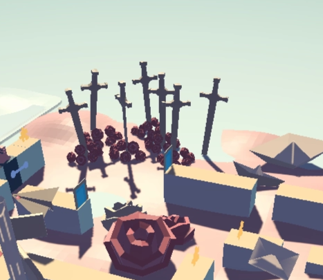
  

至于为什么采用 low poly 的风格，实在是因为时间不够 + 技术有待提高，当然也有一部分原因是我很喜欢跳舞的线（谢谢跳舞的线！）

差不多就是这样，最后放一张人员表！

