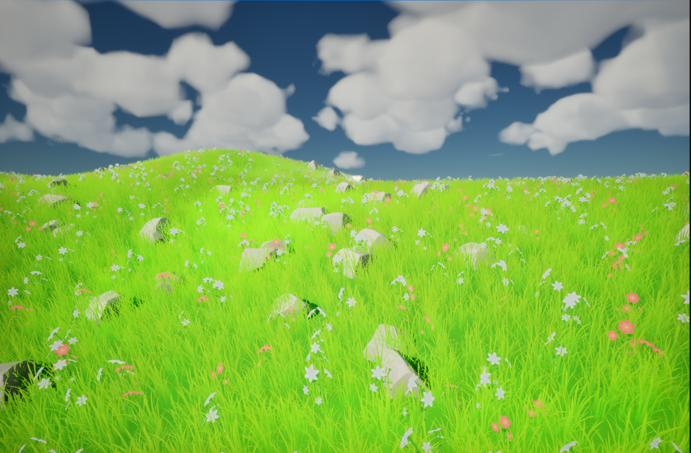
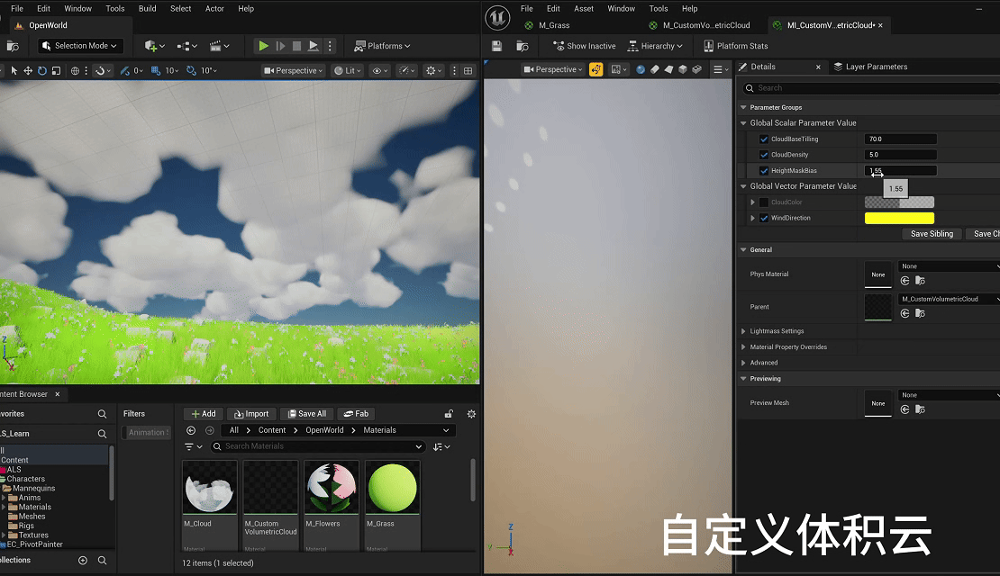

# 风格化世界 + 体积云

  

# 体积云逻辑

  

  


### 根据速度采样 3D Volume Texture

 


$$
\mathbf{uvw}
=
\frac{\mathbf{P}_{\mathrm{world}}}{S}
+
\mathbf{D}_{\mathrm{wind}}V_{\mathrm{wind}}t
$$

- $P_{world}$：当前 Ray March 采样点的世界坐标；
- $S$：云噪声的空间尺度；
- $D_{wind}$：风向；
- $V_{wind}$：风速；
- $t$：时间；
- $uvw$：用于采样 Volume Texture 的三维坐标。

### 根据高度做剔除

 


高度函数

$$
H(x)=(1−e^x)(1−e^{1−x})
$$

自定义节点代码：

```c
float x = saturate(NormAltitudeInLayer);

float a = 1.0 - exp(x);
float b = 1.0 - exp(1.0 - x);

return a * b;
```

这一步的主要计算：

$$
\rho
=
\operatorname{saturate}
\left[
N-\left(1-H(h)\right)B
\right]
$$

- $N$：基础三维噪声；
- $H(h)$：高度密度函数；
- $B$：Height Bias；
- $ρ_{raw}$：高度修正后的原始密度。

# 交互草逻辑

## 颜色逻辑

 


- 底部：大地的颜色（使用 render texture）
- 顶部：自定义颜色

## 交互逻辑

核心：设置 RotateAboutAxis

 


- 旋转轴：z 轴与Vector（玩家到草） 的叉乘

 


- Pivot Point：草的底部
- Position：Absolute Position

### 核心：计算旋转角度：

1. 记录玩家位置：把玩家位置写入 RT

 

 

 

蓝图逻辑：

 
