## Overview

## Production breakdown

### Modeling

Character models

<!-- 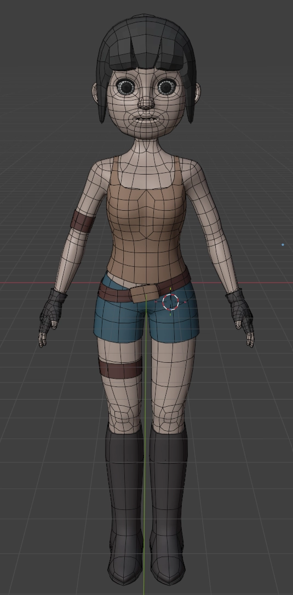
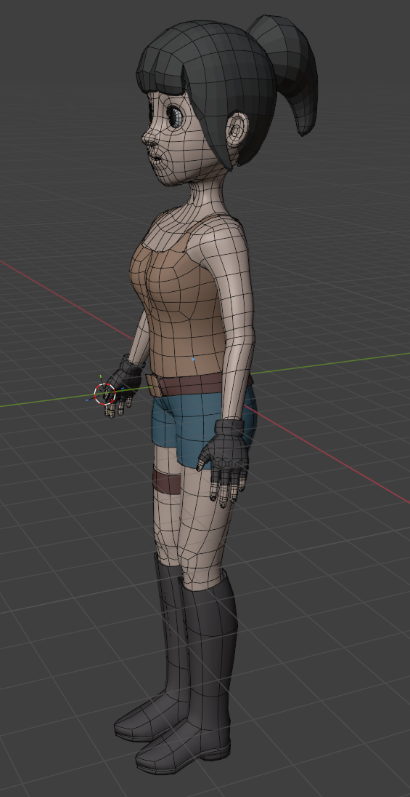
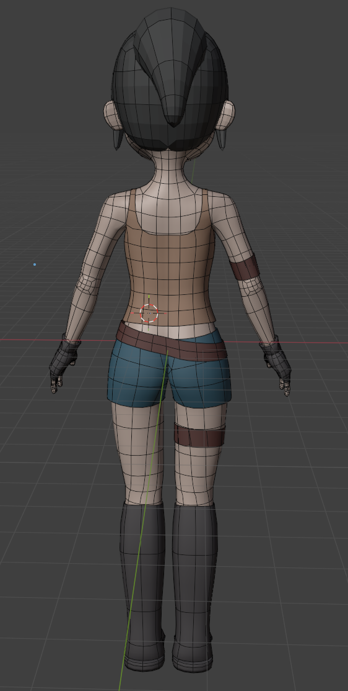
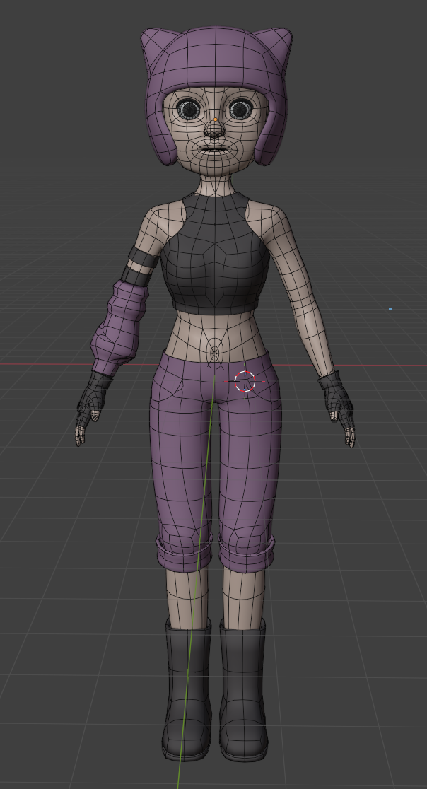
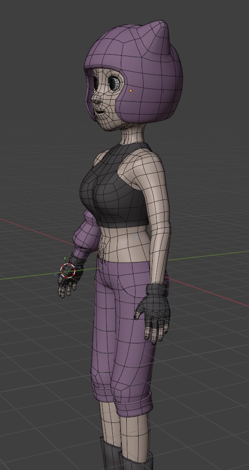
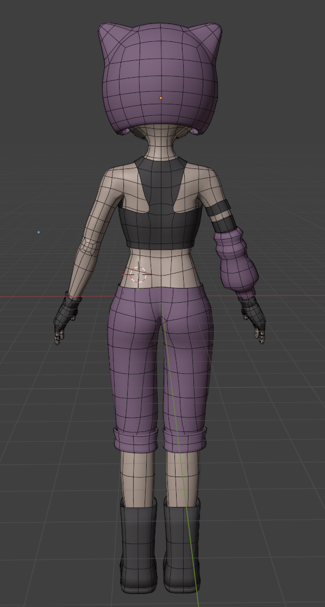
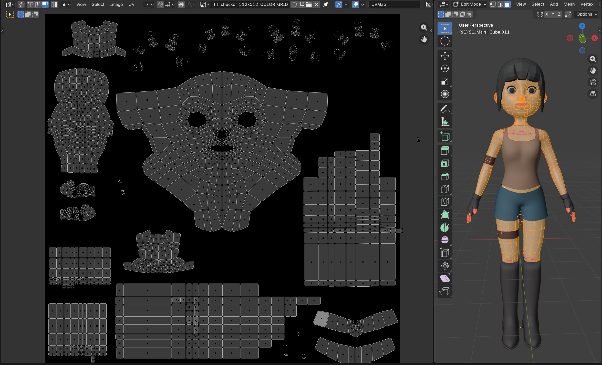 -->

  
  
  
  
  
  

UV layouts

### Character rigging and animation

I used Rigify for the human characters and added custom bones.

<!-- 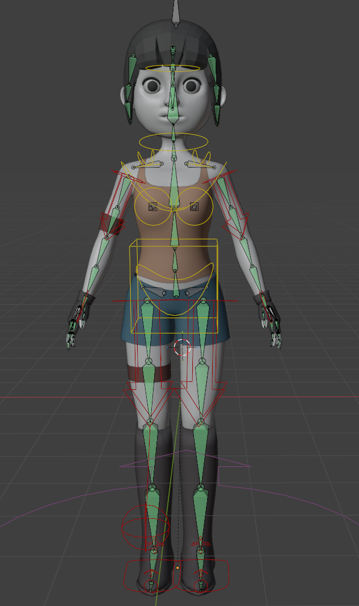
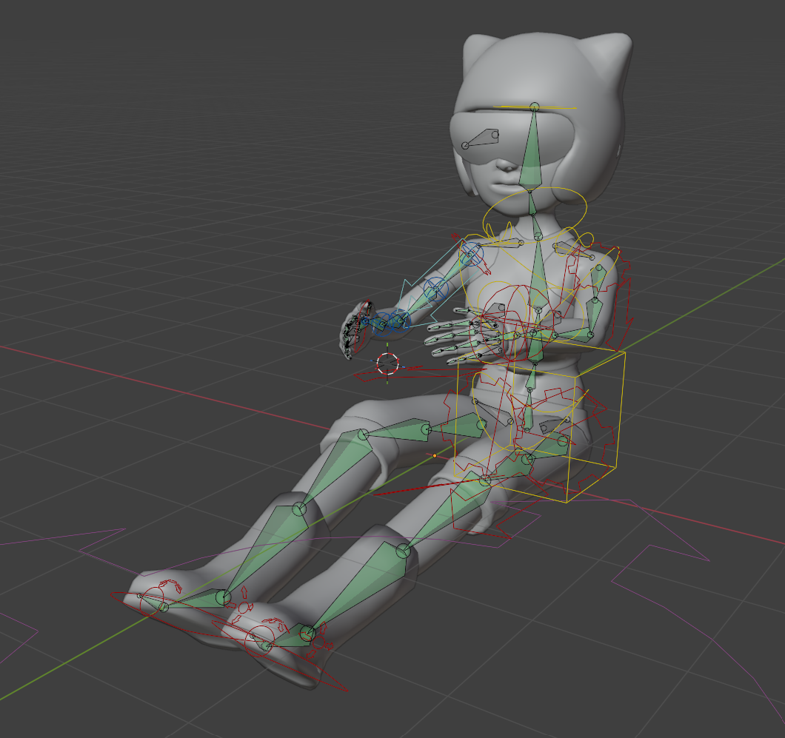 -->

  
  

For the animals, I built my own armatures and used shape keys.

  

### Geometry Nodes

Animating the cornfield

- I animated the field by interpolating between an Empty and the mesh faces.
- Each stalk changes scale with distance to make it look as though it’s growing.

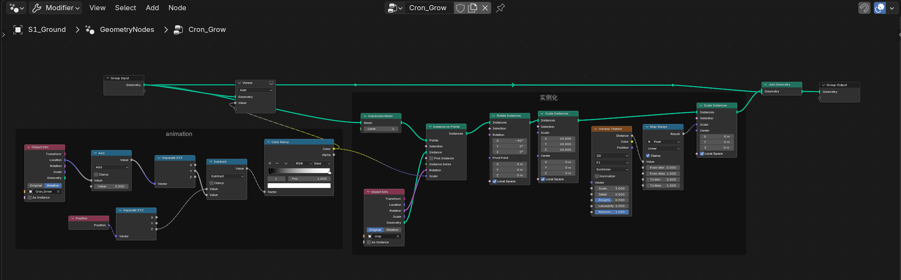

## Looking back

This was my first time taking an animation through the whole pipeline. My modeling skills were about as steady as a toddler on their feet, and my Mac had all of 8 GB of RAM. I didn’t expect the two of us to pull this off. Blender knocked me flat more than once, but watching those frames finally render one by one made me ridiculously happy.

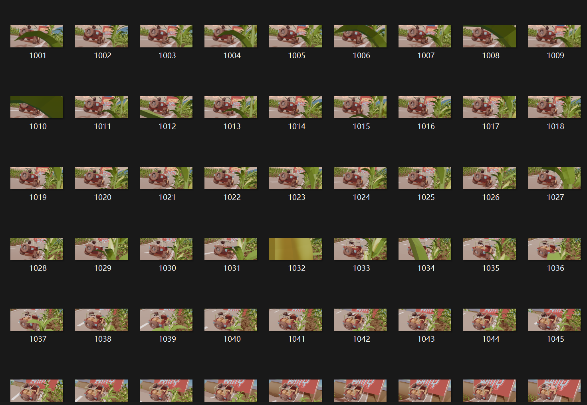

The picture below pretty much sums up where the idea came from. In the summer of 2025, the F1 movie was packing theaters. Meanwhile, I was on a driving practice course trying to figure out how to avoid hitting a wall.

  

A lot of driving schools in northeastern China are out in the countryside. Cornfields stretched as far as I could see on either side of the practice course, and some mornings farmers would come past with their sheep or cattle. My driving was terrible, but I could reliably overtake the animals. I think that’s where I got the idea of crossing over into their world for a race.

<!-- 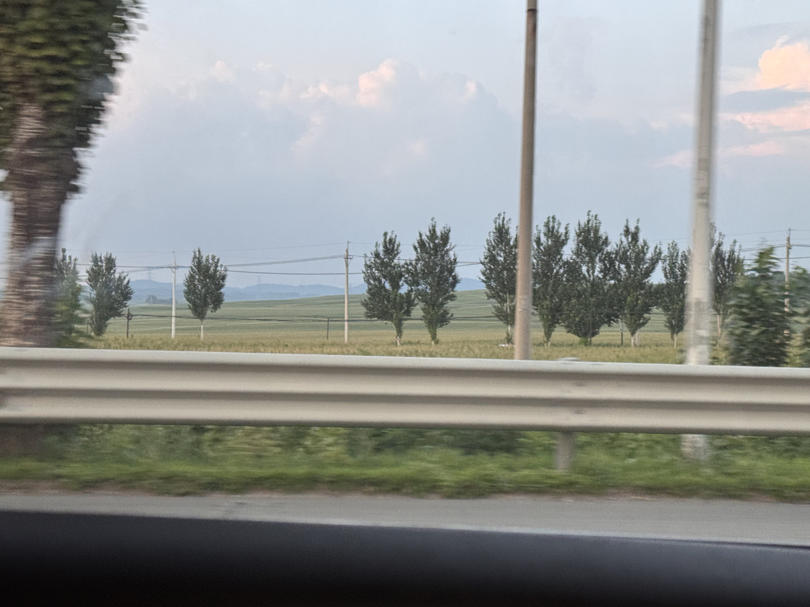
[https://www.notion.so](https://www.notion.so) -->

  
  

I figured my low-poly masterpiece would barely get a glance on social media, so I posted it with a shrug. Then all these genuinely kind comments came in. Xiaohongshu can be a lovely place.

<!-- 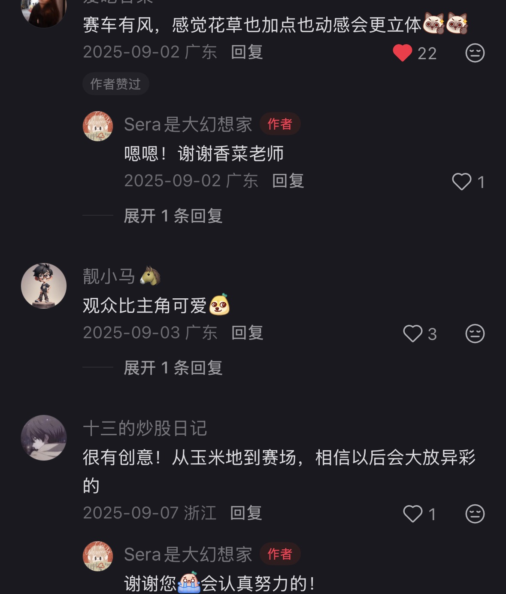
 -->

  
  

